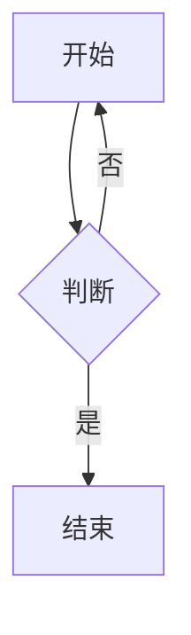

<script setup>
const greeting = '你好，mdi2esm'
</script>

# mdi2esm

A markdown-it wrapper with common plugins integrated. It renders Markdown into VitePress-style HTML, with code highlighting, math (KaTeX), Mermaid diagrams, outlines and image zoom built in. The core markdown stack and Prism are bundled into a single browser-ready ESM artifact; framework and heavy dependencies are left as peers for the host to provide.

> 这份 README 就是 demo 的渲染源：左侧可实时编辑，右侧渲染。它同时是包文档和能力全景——基础语法、容器、GitHub alerts、脚注、任务列表、图标与 emoji 短码、CJK 混排、属性、目录、代码高亮、数学、图表、图片缩放，以及宿主注入的组件（`<Badge>` / `<Icon>`）和 `<script setup>`。

::: tip 关于这份文档
顶部有 frontmatter（`title` / `description`）和一个 `<script setup>`，都由库的渲染管线处理（`<MarkdownContent>` 内部走的就是它）。下面的 `{{ greeting }}` 就是 setup 里定义的变量：**{{ greeting }}**。
:::

## 环境要求

- Node.js >= 20（见 `package.json` 的 `engines`）。
- 浏览器侧运行，运行时需要宿主的 import map 或打包器解析 peer 依赖。

## 安装

```sh
npm i mdi2esm
```

同时安装 peer 依赖（用到哪些功能装哪些；完整能力需要全部）：

```sh
npm i mdi2esm vue vue-style-runtime katex mermaid
```

## 用法

只出 HTML 字符串（不挂 Vue，纯 `innerHTML` 场景）：

```js
import { renderMarkdown, renderMath, buildOutline, createConfig } from 'mdi2esm';

const config = createConfig();
const { html, headings } = renderMarkdown('# 标题\n正文', { config });
const finalHtml = await renderMath(html, config);
const outline = buildOutline(headings);
```

挂成 Vue 组件——本页就是这段代码跑出来的，取自 `index.html` 的内联脚本（只去掉了大纲滚动同步这类页面细节）：

```js
import { Icon } from '@iconify/vue';
import { createApp, h, shallowRef } from 'vue';
import { createConfig, MarkdownContent } from 'mdi2esm';

import 'mdi2esm/index.min.css';
import 'katex/dist/katex.min.css';

import { VPBadge } from './vp-badge.js'; // 宿主自己写的 <Badge>

// md 里用到的组件集中登记一处——库内一个都不含
const HOST_COMPONENTS = { Icon, Badge: VPBadge };

const config = createConfig({
  markdown: { container: [{ type: 'demo', title: '自定义容器' }] },
});

// 1. 取源文本：库只吃字符串，跟构建工具无关——fetch、接口返回、textarea 内容都行
//    放进 ref 就是响应式的：改一次 source.value 重编译一次（demo 的「渲染」按钮干的就这一件事）
const source = shallowRef(await fetch('./README.md').then((res) => res.text()));

// 2. 渲染就是一个标签：编译、注入组件、挂载都在内部完成
createApp({
  render: () => h(MarkdownContent, { source: source.value, config, components: HOST_COMPONENTS, onHeadings }),
}).mount(document.getElementById('content'));

// 3. 大纲从组件抛出的 headings 生成（renderOutline 是 demo 自己的 DOM 渲染，见 index.html）
function onHeadings(headings) {
  renderOutline(buildOutline(headings), document.getElementById('outline'));
}
```

`<MarkdownContent>` 的入参都是纯数据，取文本、存文本、把大纲画成什么 DOM，全由调用方决定：

| 属性 / 事件  | 说明                                                                                            |
| ------------ | ----------------------------------------------------------------------------------------------- |
| `source`     | markdown 文本；变化时自动重编译，内部按序号丢弃过期结果                                         |
| `dir`        | 相对链接、相对 `import` 的基准目录                                                              |
| `config`     | `createConfig()` 的产物；不传用默认配置                                                         |
| `components` | md 里出现的组件（`<Icon>` / `<Badge>` …），只在编译时注入                                       |
| `@headings`  | 编译完抛出 `[{ level, title, slug }]`，`buildOutline` 再整理成 `{ title, link, children }` 的树 |

只要 HTML 字符串、不需要 Vue 组件时，用上面第一节的 `renderMarkdown`——两者的区别只在于要不要把结果挂成组件。

`index.html` 里取源文本就是一句 `fetch('./README.md')`——库只吃字符串，文本从哪来跟它无关，`fetch`、接口返回、`textarea` 内容都一样。

`package.json` 的 `exports` 提供两个 JS 入口：默认（生产）指向压缩版 `dist/index.min.js`，`development` 条件指向未压缩的 `dist/index.js`；也可显式用 `mdi2esm/index` 与 `mdi2esm/index.min`。

### 不打包：浏览器原生 ESM + importmap

`dist/index.min.js` 本身就是浏览器可加载的 ESM，静态导入只有 `vue` 和 `vue-style-runtime` 两个（`katex` / `mermaid` 是动态 `import()`，用到才加载）。所以连 Vite 都不需要，importmap 映射 peer 即可：

```html
<script type="importmap">
  {
    "imports": {
      "vue": "/node_modules/vue/dist/vue.esm-browser.prod.js",
      "vue-style-runtime": "/node_modules/vue-style-runtime/index.js"
    }
  }
</script>

<script type="module">
  import { createApp, h } from 'vue';
  import { createConfig, MarkdownContent } from '/node_modules/mdi2esm/dist/index.min.js';

  // 组件就是一个带 template 字符串的对象，没有 SFC，也没有编译步骤
  const Badge = {
    props: ['text', 'type'],
    template: '<span class="badge" :data-type="type"><slot>{{ text }}</slot></span>',
  };

  const source = await fetch('./README.md').then((res) => res.text());
  const config = createConfig();

  // 运行时编译，和打包场景一样
  createApp({
    render: () => h(MarkdownContent, { source, config, components: { Badge } }),
  }).mount('#app');
</script>
```

**Vue 必须是含模板编译器的构建**，这条最容易踩。`createMarkdownComponent` 内部用 `compile()` 把 Markdown 编成模板，而 runtime-only 版的 `compile` 是个直接抛错的占位：

| 场景          | 要用的文件                                              |
| ------------- | ------------------------------------------------------- |
| importmap     | `vue/dist/vue.esm-browser.prod.js`（或 `.js`）          |
| Vite / Rollup | `resolve.alias: { vue: 'vue/dist/vue.esm-bundler.js' }` |
| webpack       | `resolve.alias: { vue: 'vue/dist/vue.esm-bundler.js' }` |

裸 `import ... from 'vue'` 在打包器里默认解析到 `vue.runtime.esm-bundler.js`，少了上面这条 alias，`MarkdownContent` 和 `createMarkdownComponent` 都会在 `compile is not a function` 上挂掉。上面「挂成 Vue 组件」的示例同样要配。

本仓库的 demo 在 `index.html`（整页自包含：骨架、内联样式、内联脚本——宿主组件 `VPBadge` 与左编辑右预览逻辑都在里面），由 Vite 接管两种运行方式：

- `npm run dev`：Vite 服务根目录 `index.html`，内联脚本里的裸导入由 Vite 重写到**源码**（`mdi2esm` 经 `vite.config.mjs` 的 alias 指到 `src/index.full.js`）——改 src 立即生效。
- `npm run demo`（= build + `npm run preview`）：build 把 `index.html` 当入口打进 `dist/`，所有导入解析成打包产物，**dist 自包含**——整个目录发布到 GitHub Pages（或任意静态托管）就能直接演示，无 importmap、无 node_modules 依赖；`vite preview` 服务 dist（4180 端口）。

推 `v*` Tag 时 GitHub Actions（`.github/workflows/publish.yml` 的 `pages` job）会构建并把 dist 部署到 `gh-pages` 分支（仓库 Pages 源需指向 gh-pages / root）。

## 部署路径（base）

md 里的相对链接、图片、`<script setup>` 里的相对 import，最终 URL 都由 `createConfig({ base })` 决定。默认 `'/'`，即站点部署在域名根；放到子路径时传实际前缀：

```js
createConfig(); // ./guide/a.md → /guide/a
createConfig({ base: '/docs/' }); // ./guide/a.md → /docs/guide/a
```

`base` 不会出现在配置对象上——`createConfig` 内部把它编成 `adapters`（`toHref` / `toSrc` / `toScriptImport` / `anchorHref` / `scriptContext`），渲染层只读 `config.adapters`，不会出现两个真相来源。需要非标准规则（比如把 `index.md` 归一成目录、把图片改写到 `/public`）时，覆写对应那一个函数即可，其余仍按 `base` 生成：

```js
createConfig({
  base: '/doc/',
  adapters: {
    // guide/index.md → /doc/guide/（默认实现不把 index 归一成目录）
    toHref: ({ path, resolved, hash }) => {
      if (!/\.md$/i.test(path)) return `/doc/${resolved}${hash}`;
      const route = resolved.replace(/\.md$/i, '').replace(/index$/i, '');
      return `/doc/${route}${hash}`;
    },
  },
});
```

KaTeX 的样式不属于路径配置，库也不注入 `<link>`：`katex/dist/katex.min.css` 由宿主自己引入（见上一节）。

## 样式

渲染产物的类名沿用 VitePress 风格（`.vp-doc`、`.custom-block` 等）。包内附带一套只覆盖 markdown 正文与页内目录（`.vp-doc`、`.vp-doc-outline`）的样式：

```js
import 'mdi2esm/index.min.css';
```

也可用未压缩的 `mdi2esm/index.css`。这套样式不包含站点 header、sidebar、nav、搜索等布局，宿主可以在 `:root` / `.dark` 上覆盖 `--vp-*` 变量做主题定制。代码高亮由 Prism 生成 `token` 类，配色已包含在样式里；Prism 本身已内联，无需额外安装。

`<Badge>` 这类主题组件不在包内，但样式随包发布：`index.css` 已包含 `.VPBadge` 规则与 `--vp-badge-*` 变量，宿主只需提供组件脚本。mdoc 已有自己的主题样式，只引脚本、不引这套 CSS；纯 ESM 场景同时引 CSS 与组件即可。

KaTeX 的样式与字体属于 peer，由你安装的 `katex` 包提供，需自行引入：

```js
import 'katex/dist/katex.min.css';
```

## 目录

[[toc]]

正文的 `[[toc]]` 自动生成上面的目录（`.table-of-contents`，卡片式、按层级缩进）。右侧"大纲"栏由 `buildOutline(headings)` 从 h2–h6 生成，两者互相独立，见下面的「大纲」。

## 基础语法

普通段落，支持 **加粗**、_斜体_、~~删除线~~、`行内代码`，以及 [外部链接](https://example.com) 和 [邮件](mailto:a@example.com)。

> 这是一段引用。
> 引用可以有多行。

- 无序列表项 A
- 无序列表项 B
  - 嵌套项 B1

1. 有序列表项一
2. 有序列表项二

---

| 能力       | 提供方               | 说明                             |
| ---------- | -------------------- | -------------------------------- |
| 表格可滚动 | applyTablePlugin     | 表格带 `tabindex="0"`            |
| 实体还原   | applyRestoreEntities | 裸 `&` 转 `&amp;`，`&copy;` 保留 |

A & B &copy; C，裸域名 example.com 不会自动成链（`fuzzyLink: false`）。

## 自定义容器

八种内置容器，支持自定义标题、`{no-title}`、`{open}`：

::: info
默认标题的 info 容器。
:::

::: note 这是自定义标题
note 容器，标题写在类型后面。
:::

::: important
重要提示。
:::

::: caution
小心操作。
:::

::: warning 无标题示例 {no-title}
本容器用了 `{no-title}`，不渲染标题栏。
:::

::: details 点击展开（默认折叠）
折叠内容，支持 **Markdown**。
:::

::: details 默认展开 {open}
本容器带 `{open}`，打开页面即展开。
:::

::: danger
危险操作警告。
:::

内置容器写死在包里；自定义容器需要宿主在 `createConfig` 里声明，再用 `::: 类型名` 触发：

```js
const config = createConfig({
  // type 是触发词，title 是默认标题；正文里写 `::: demo 别的标题` 会覆盖它
  markdown: { container: [{ type: 'demo', title: '自定义容器' }] },
});
```

`type` 不能与内置八种重名（会抛错）。本页的 `demo` 容器就是这么来的：

::: demo
这是一个**自定义容器**类型 `demo`，不属于内置八种；在 GitHub 上它显示为普通文本。
:::

库只负责产出 `<div class="demo custom-block">` 这个结构，**配色不由库提供**——内置八种有各自的 `--vp-c-*` 色板，未知类型的 `.demo` 只是 `border: 1px solid transparent` 加圆角和内边距，不写 CSS 就看不出来（像上面这段在纯库样式下是个透明块）。要它像容器，宿主自己补一条：

```css
.vp-doc .custom-block.demo {
  border-color: var(--vp-c-brand-1);
  background-color: var(--vp-c-brand-soft);
}
.vp-doc .custom-block.demo .custom-block-title {
  color: var(--vp-c-brand-1);
}
```

本页看到的就是加了这段之后的效果（`index.html` 内联样式末尾）。想验证裸效果：先把上面两条 CSS 注释掉，块会变成与正文无异的白板。

## GitHub Alerts

用 `> [!TYPE]` 语法，渲染成与自定义容器同款 block：

> [!TIP]
> 这是一条 TIP alert。

> [!NOTE] 带标题的 NOTE
> 标题写在类型后面。

> [!WARNING]
> 这是一条 WARNING alert。

## 任务列表

- [x] 已完成：标题锚点
- [x] 已完成：代码高亮
- [ ] 待办：阅读本文
- [ ] 待办：试试编辑左侧源码

## 脚注

正文里的脚注引用[^1]，以及行内脚注^[这是行内脚注内容]。

[^1]: 这是脚注定义，可以包含 **Markdown**。

## 短码（图标 / Emoji）

行内图标短码输出**组件标签**，组件由宿主注入；emoji 则交给 markdown-it-emoji 插件：

| 写法            | 输出                        | 说明                                        |
| --------------- | --------------------------- | ------------------------------------------- |
| `:i-集合-名字:` | `<Icon icon="集合:名字" />` | `i-` 是固定前缀，第一段是集合，其余是图标名 |
| `:名字:`        | 对应的 emoji 字符           | 由 markdown-it-emoji（full 数据）渲染，见下 |

- **emoji 不内置**：库动态 `import('markdown-it-emoji')`（full 数据，GitHub / VitePress 同套），宿主提供了就启用；没装时静默回退，`:名字:` 按普通文本原样保留。demo 已装该包，构建时直接打进产物（npm 包消费者仍需自行安装——库对它是可选 peer）。
- **图标规则不受影响**：`:i-mdi-home:` 翻成 `<Icon>`；`:i-foo:` 这种形状不完整的保持原文，不会被 emoji 接走。
- **不误判**：`12:30:00`、`1:2:3` 这类时间和版本号不在 emoji 短码表里，原样保留。
- 代码块与行内代码里不生效（markdown-it 自身隔离）。

实际效果：图标 :i-logos-vite: :i-lucide-rocket: ｜ emoji :smile: :tada: :+1: :heart: :rocket: :100: ｜ 原样保留：12:30:00、1:2:3、:i-foo:。

CJK friendly：这是**中文**加粗English混排，数字123与汉字相邻，无需手动加空格即可正确解析强调标记。

```md
短码：:i-lucide-rocket: ｜ emoji：:smile: :tada: :+1: :100:
```

## 图标（Iconify）

包内不提供 `<Icon>` 组件，也不自动引入 `@iconify/vue`。宿主把 `Icon` 注入到 Vue 之后，md 里就能直接写：

```md
<Icon icon="logos:vite" width="24" height="24" />
<Icon icon="lucide:rocket" />
```

短码与原始标签等价，要控制尺寸、颜色时用后者：<Icon icon="logos:vite" width="28" height="28" /> <Icon icon="skill-icons:typescript" width="28" height="28" /> <Icon icon="lucide:rocket" width="28" height="28" />

这几个都靠联网获取（Iconify 默认 API），离线、内网或集合不存在时留空，需要离线就按下面注册。怎么注入见「组件接入」——mdi2esm 不持有图标实例，就不会把「`@iconify/vue` 必须单实例」变成宿主的默认约束；宿主用哪个版本、哪个图标集完全自己决定。

包内不内置图标集，也不注册图标数据。未注册的图标由 Iconify 默认 API `api.iconify.design` 联网获取，离线、内网或无此图标时会留空。需要离线渲染时，安装 `@iconify-json/*`，用 Iconify 官方的 `addCollection` / `addIcon` 注册（对宿主的 `<Icon>` 直接生效，后注册也有效，Iconify 会通知已渲染的图标重绘）：

```js
import { addCollection, addIcon } from '@iconify/vue';
import { icons } from '@iconify-json/lucide';

addCollection(icons); // 整个集合
addIcon('my:star', { body: '<path d="M12 2l2.4 6.6L21 11l-6.6 2.4L12 20l-2.4-6.6L3 11z"/>', width: 24, height: 24 });
```

需自行安装 `@iconify/vue`（可选 peer），并保证它作为外部依赖只保留一份，打包器场景要显式去重：

```js
// Vite
export default { resolve: { dedupe: ['@iconify/vue'] } };

// Rollup
nodeResolve({ dedupe: ['@iconify/vue'] });

// webpack
resolve: { alias: { '@iconify/vue': path.resolve('node_modules/@iconify/vue') } };
```

再用 `npm ls @iconify/vue` 或 `npm dedupe` 确认依赖树只有一份。判断是否出现双实例：注册后 `getIcon('lucide:rocket')` 有值，但页面上的 `<Icon icon="lucide:rocket">` 仍然请求网络或空白，基本就是两份模块实例。

## 组件接入（Vue）

库只内置 `ClientOnly`，md 里用到的自定义组件（`<Icon>`、`<Badge>` 等）都由宿主提供——否则模板里的标签解析不到，就是空白。

用 `<MarkdownContent>` 时把它们写进 `components` 属性，注入在组件内部完成，不污染全局：

```js
h(MarkdownContent, { source, config, components: { Icon, Badge: VPBadge } });
```

底层是 Vue 自身的机制，两种写法任选其一：

- **局部**（`<MarkdownContent>` 内部就是这么做的）：`component.components = { ...component.components, ...HOST_COMPONENTS }`，只对这一个 markdown 组件生效，不污染全局。
- **全局**：在 `createApp` 之后、`mount` 之前注册，整个 app 通用：

  ```js
  const app = createApp({ render: () => h(MarkdownContent, { source, config }) });
  app.component('Icon', Icon); // 之后任意组件的模板里都能写 <Icon>
  app.component('Badge', MyBadge);
  app.mount(document.getElementById('app'));
  ```

两者不要混用；`<Icon>` 只要能被模板解析到即可，与图标数据注册（`addCollection` / `addIcon`）是两回事——后者是往图标仓库塞 svg，和组件注入互不影响。

### 在 Markdown 中使用 Vue

Markdown 最终被编译成 Vue 模板，所以插值、指令和组件都能直接使用（与 VitePress 一致）；前提是走 `<MarkdownContent>` 或 `createMarkdownComponent`（都会把 md 编成模板再渲染），纯 `renderMarkdown` 只出 HTML 字符串。

**插值**：1 + 1 = {{ 1 + 1 }}。

**指令**（原始 HTML 在 Markdown 中同样有效）：

<span v-for="i in 3" :key="i" style="margin-right: 6px;">{{ i }}</span>

**转义**：用 `v-pre` 让插值保持字面量 —— <span v-pre>{{ 这里不会被编译 }}</span>

**组件**：`<Badge>` 见下一节；组件名请用 PascalCase 或带连字符，否则会被当成行内元素包进 `<p>`。

**脚本**：根级 `<script setup>` 可用，变量会注入模板（本页顶部就有），见「脚本能力」。相对路径的 `import` 由宿主适配器解析，裸包名交给 importmap。

### 宿主注入的组件（Badge / Icon）

徽标由宿主提供（`index.html` 内联定义 `VPBadge`），每个徽标独占一段，避免被 markdown-it 当成嵌套标签：

<Badge text="new" type="tip"></Badge>

<Badge text="beta" type="warning"></Badge>

<Badge type="danger">插槽内容</Badge>

`<Badge>` 支持 `text` / `type` 与默认插槽。这类 HTML-in-Markdown 需要 Vue 运行时，纯 `renderMarkdown` + `innerHTML` 的挂载方式无法演示。

## 属性语法与标题锚点

带属性的标题 {#custom-heading .my-class}

把鼠标移到上面的标题，可见自动生成的锚点（`.header-anchor`）；`{#custom-heading}` 覆盖默认 slug，`.my-class` 作为类名挂到标题上。普通文本里的 **加粗**{.highlight} 也能加属性。

## 代码高亮

### 语法着色与行高亮

```js [示例.js] {1,3} :line-numbers=2
const a = 1;
const b = 2;
const c = 3;
const d = 4;
const e = 5;
```

`[示例.js]` 给代码块加标题，`{1,3}` 高亮指定行，`:line-numbers=2` 从第 2 行开始编号。

### 代码组（多 Tab）

::: code-group

```js [npm]
npm i mdi2esm
```

```pnpm [pnpm]
pnpm add mdi2esm
```

```yarn [yarn]
yarn add mdi2esm
```

:::

点击 Tab 可切换代码块。

### 关闭行号

```ts:no-line-numbers
const plain = true
```

### 语言覆盖

代码块支持 TIOBE 前 20 中 Prism 有语法的部分（Scratch 除外），再加上文档常用语言：`python` `c` `cpp` `java` `csharp` `javascript` `visual-basic` `go` `sql` `pascal`（Delphi）`fortran` `r` `rust` `php` `matlab` `kotlin` `ruby` `swift` `nasm`（汇编），以及 `bash` `batch` `diff` `docker` `ini` `json` `markdown` `nginx` `powershell` `typescript` `yaml`；`markup`（html/xml/svg）、`css`、`clike` 由 Prism 核心自带。别名如 `c++`、`c#`、`delphi`、`vb`、`asm`、`sh`、`yml`、`md`、`vue` 会自动归一化。

## 数学公式（KaTeX）

行内公式 $E = mc^2$，块级公式：

$$
\int_0^1 x^2 \, dx = \frac{1}{3}
$$

段落内联 `$$a+b$$` 按块级处理；价格 \\$5 不会被误当成公式。公式由 `renderMath()` 异步渲染，样式需宿主引入 `katex/dist/katex.min.css`。

## Mermaid 图表



点击右上角"深色"按钮切换主题，Mermaid 会随 `html.dark` 自动重绘。

围栏会被渲染成 `<MermaidBlock graph="…">`（源码经 `encodeURIComponent` 传入），图形由该组件在自身挂载后写入自己的根节点，不查 document，页面上有几份 Markdown 互不干扰。`mermaid` 是动态 `import()`，没有图表就不会加载。

## 图片与缩放


[](https://example.com)

点击第一张图片可用 medium-zoom 放大（图为本地资源，离线也能显示）；被链接包裹的图片按规则排除缩放。图片还被自动加上 `loading="lazy"`。

复制按钮、code-group 切 tab、图片缩放这些交互**由库自带**：复制与切 tab 是文档级的一次 click 委托（对齐 VitePress 的 copyCode/codeGroups），缩放由组件挂载后动态 `import('medium-zoom')` 装配（仅当正文有可放大图片；未安装 medium-zoom 时静默跳过）。宿主零配置；要换剪贴板策略或缩放库时才需要自己在宿主侧接管。

## 脚本能力（script setup）

根级 `<script setup>` 由管线编译进组件，变量可直接在正文插值——本页顶部的 `greeting` 渲染出来是：**{{ greeting }}**。相对路径的 `import` 走宿主的 `toScriptImport` 适配器，裸包名交给 importmap。

普通 `<script>` 也可以写，用来挂生命周期：

<script>
export default {
  mounted() {
    console.log('[mdi2esm demo] 文档组件已挂载')
  }
}
</script>

## 语法糖与 frontmatter

三条常用内联语法默认开启，可在 `config.markdown` 里关掉：

```md
==高亮== → <mark>高亮</mark>
H~2~O → H<sub>2</sub>O
x^2^ → x<sup>2</sup>
```

- `==高亮==` → ==高亮==
- `H~2~O` → H~2~O
- `x^2^` → x^2^

```js
createConfig({ markdown: { mark: false, sub: false, sup: false } });
```

开关按 `md` 实例生效（首次渲染前应用），同一进程不支持多套配置共存；代码块与行内代码里不会生效（`==高亮==`、`H~2~O`），行内脚注 `^[注释]` 与上标规则不冲突。

frontmatter 会被解析并挂到 `$frontmatter`，所以本页可以直接取值：**{{ $frontmatter.title }}**，描述是：{{ $frontmatter.description }}。内置解析器只支持 YAML 子集（标量、一层嵌套、数组、行内数组）：

```md
---
title: 快速开始
order: 3
aside: [toc]
---
```

```js
// 需要完整 YAML（多行块、锚点等）时替换解析器，返回 { body, data }
createConfig({ markdown: { frontmatterParser: (raw) => yamlFrontmatter(raw) } });

// 宿主已解析好时直接传入，不会重复解析
createMarkdownComponent(source, dir, config, { frontmatter: page.fm });
```

## 大纲

右侧"大纲"栏由 `buildOutline(headings)` 从本页 h2/h3 生成，试试增删二级/三级标题，大纲会同步更新。它的尺寸、层级与状态取值与 VitePress 的 `VPDocAsideOutline` / `VPDocOutlineItem` 一致：1px 发丝线、1rem 内缩、链接 14px / 行高 2.2857143、当前项取 `--vp-c-text-1`，另带图样相同的 2px `.outline-marker`。

当前项由宿主做滚动同步：给链接加 `.active`（或 `aria-current="location"`），并把 `.outline-marker` 的 `top`、`opacity` 设到对应位置；demo 实现见 `index.html` 的内联脚本。

## 独立代码块

不在 markdown 内、由宿主组件自行渲染代码时，直接用 `highlightBlock`，与正文代码块共用同一套 Prism 语法与行切分：

```js
import { highlightBlock } from 'mdi2esm';

const { html, lang, ok } = highlightBlock(code, 'ts', { meta: '{2,4-5}' });
// html: <pre class="language-ts"><code><span class="line">…</span></code></pre>
// ok: false 表示语言未注册，内容已转义为纯文本
```

配套约定：

1. 宿主容器加 `mdi-code` 类，token 配色才会生效（`index.css` 里的规则是 `:is(.vp-doc, .mdi-code) .token`，深色走 `.dark`）。
2. 行号、折行、最大高度等布局由宿主控制；`html` 里每行已包好 `.line`，行号用 `counter` 实现即可。
3. 需要注册额外语言或直接用 `Prism.highlight` 时，用导出的 `Prism`：`Prism.languages.demo = {…}`。

## 公共 API

包入口导出以下能力（无需记忆内部模块路径）：

- 配置：`createConfig`、`createBaseAdapters`、`DEFAULT_CONFIG`、`DEFAULT_ADAPTERS`、`CONTAINER_LABELS`、`COPY_LABELS`
- 渲染环境：`createRenderEnv`
- 渲染：`renderMarkdown`、`renderSource`、`renderMath`、`md`（markdown-it 实例）、`ensureCustomContainers`、`ensureSyntaxPlugins`、`buildOutline`、`escapeInvalidInterpolations`、`resolvePath`
- 代码块：`applyCodeBlock`、`maskFenceMarkers`、`unmaskFenceMarkers`、`highlightCode`、`highlightBlock`、`normalizeLang`、`Prism`
- 组件：`MarkdownContent`（客户端标签式入口，支持 `app.use()` 全局注册）、`MermaidBlock`（```mermaid 的渲染组件，管线自动注册）
- 管线：`createMarkdownComponent`、`extractTopLevelBlocks`
- 其它：`parseFrontmatter`、`stripFrontmatter`
- 浏览器脚本模块：`createScriptModule`、`createSetup`、`buildScriptModuleSource`、`buildSetupModuleSource`
- Markdown 插件辅助：`anchorHref`、`normalizeHash`、`applyRestoreEntities`、`applyTablePlugin`、`applyLineNumbers`、`fenceMetaAttrs`、`escapeHtml`

`renderMarkdown(source, { dir, config })` 返回 `{ html, headings }`；`renderMath(html, config)` 异步返回注入 KaTeX 后的 HTML；`buildOutline(headings)` 生成树形大纲。

## 开发

```sh
npm install          # 安装依赖
npm run build        # dist/index.js、dist/index.min.js、两份 CSS，外加 Vite 构建的自包含 demo（index.html + assets、public/、README.md）
npm run dev          # Vite 开发服务（根目录 index.html，引用 src 源码，改源码即时生效）
npm run demo         # build + vite preview（http://127.0.0.1:4180），跑 dist 构建产物
npm test             # 运行 node:test 测试
npm run lint         # eslint 检查（--max-warnings 0）
npm run lint:fix     # eslint 自动修复
```

demo 只有这一种形态，整页自包含：`index.html` 一个文件集齐骨架、内联样式（宿主侧 `.vp-doc` 外壳）、内联脚本（宿主组件 `VPBadge` + 左编辑右预览逻辑）。dev 由 Vite 重写裸导入直跑源码；build 由 Vite 打进 `dist/`（所有依赖含 mermaid 异步 chunk、KaTeX 字体都在产物里），preview 与 GitHub Pages 消费的同一份产物。渲染源是包文档 README.md（构建时拷成 `dist/demo.md`，运行时 `fetch`——换名是为了不让 `files` 白名单把 dist 里的示例源带进 npm 包），改 README 要重新 `npm run build`。左列 textarea 编辑（输入防抖 400ms 实时预览），右列渲染结果，最右是大纲。

库构建使用 Vite 8（rolldown 打包），只产出 `dist` 下的库文件，不构建 demo。宿主项目通过 npm 安装本包后，用 npm2esm 等工具预构建为浏览器 ESM 产物并配合 import map 使用。

## 发布说明

`package.json` 中的 `repository` / `homepage` / `bugs` 指向 `https://github.com/nbaxp/mdi2esm`。

发布由 `.github/workflows/publish.yml` 承载：推送 `v*` Tag（或手动选择 `v*` Tag 且 `dry_run=false`）时，校验 Tag 与 `package.json` 版本一致，执行测试、lint、构建、`npm pack`、`npm publish <tgz>` 并创建 GitHub Release；手动触发默认只做 `npm publish --dry-run`。`dist` 被 gitignore、由 `npm run build` 生成，无需提交。

### 首次发布（新包）

CI 的 `npm publish` 走 OIDC Trusted Publisher，但**新包尚未发布时，npm 侧没有 Settings 页面，无法预先配置 Trusted Publisher**。因此首次推 Tag 会在 Publish 步骤返回 `404 Not Found`（不是包内容问题，前面测试/lint/build/pack 都会通过）。首次发布须按顺序：

1. 本地构建并打包：`npm run build && npm pack`，得到 `mdi2esm-<version>.tgz`。
2. 本地用 2FA OTP 发首版：`npm publish mdi2esm-<version>.tgz --access public --otp=<OTP>`。
3. 包发布后，到 https://www.npmjs.com/package/mdi2esm/settings/access → Trusted Publisher → GitHub Actions，填 owner `nbaxp`、repo `mdi2esm`、workflow `publish.yml` 保存。
4. 之后推 `v*` Tag 即可由 CI 用 OIDC 自动发布，无需 OTP。

### 后续发版

1. 确认 `npm test`、`npm run lint` 全过。
2. `npm version patch` / `minor` / `major` 更新版本并打同名 Tag（如 `v0.1.2`）。
3. 提交改动、推送 `main` 与 Tag；工作流自动完成构建、发布与 Release。
