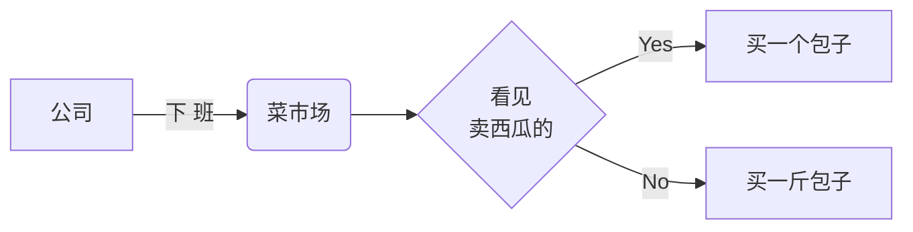
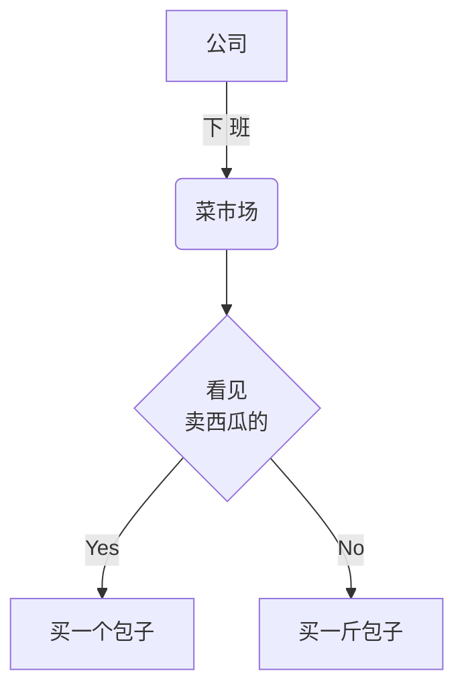
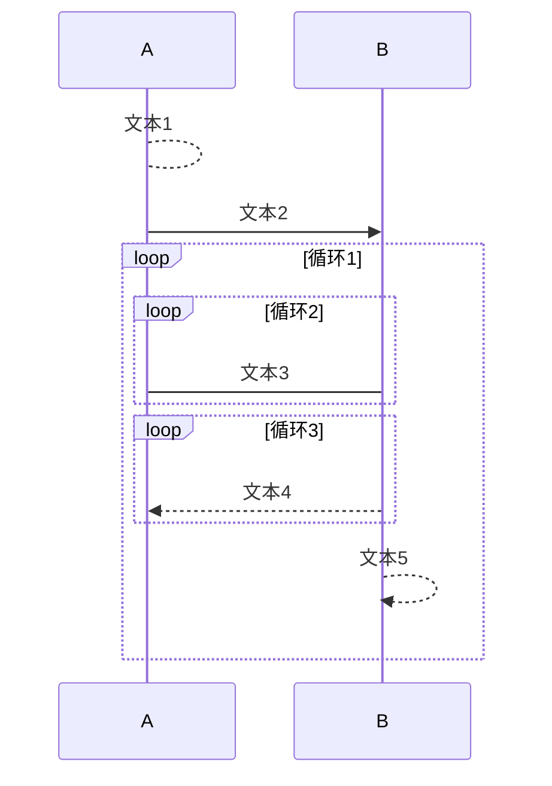
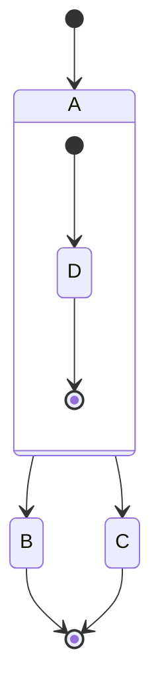
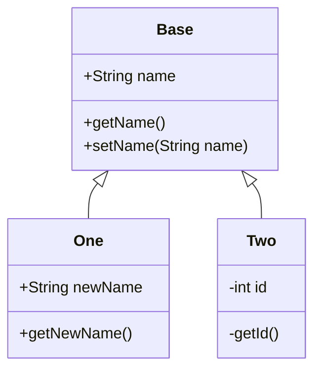
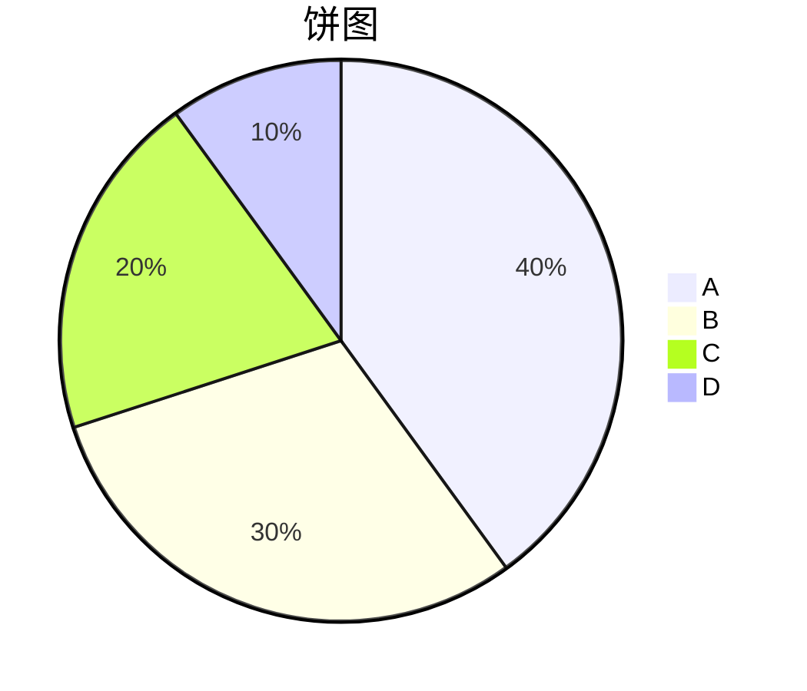
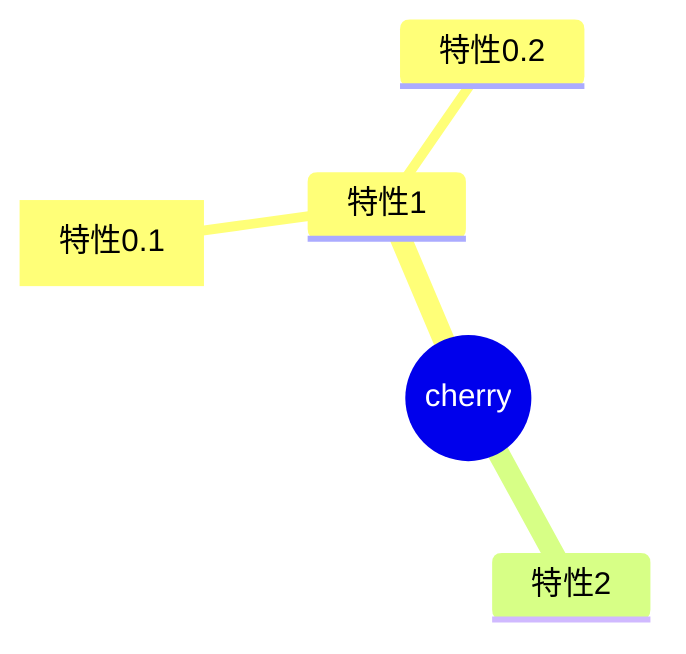
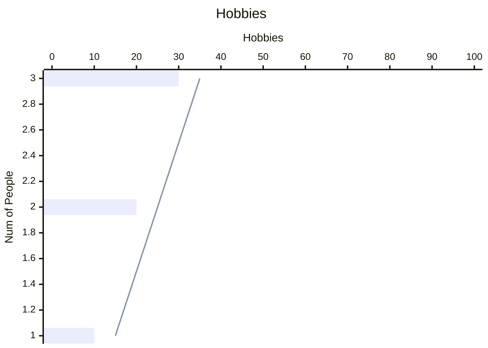
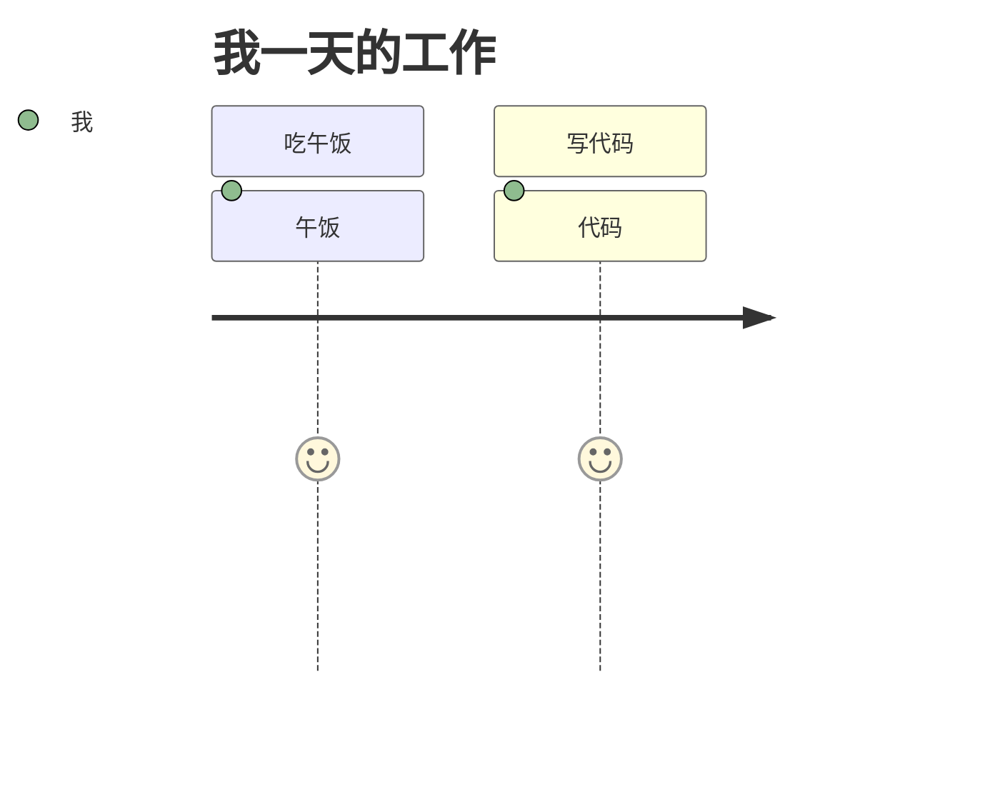

<script setup>
const greeting = '你好，mdi2esm'
</script>

# mdi2esm 演示

这是 demo 的渲染源：左侧可实时编辑、右侧渲染。内容分三块：

- **VitePress**：官方 [Markdown 扩展](https://vitepress.dev/zh/guide/markdown) 文档的逐字复制（以中文版为准，补齐英文版独有章节）。官方有、mdi2esm 未实现的语法也照录，并在对应位置标注；库自身能力与实现差异统一见「其他」。
- **CherryMarkdown**：对齐 cherry-markdown 官方示例。
- **其他**：mdi2esm 自有能力与实现差异。

::: tip 关于这份文档
顶部有 frontmatter（`title` / `description`）和一个 `<script setup>`，都由库的渲染管线处理（`createMarkdownComponent` 内部走的就是它）。下面的 `{{ greeting }}` 就是 setup 里定义的变量：**{{ greeting }}**。
:::

## VitePress

以下按 VitePress 官方中文文档逐字复制，英文版独有章节一并补齐；示例原文不作改动，库与官方的差异集中说明如下：

::: warning 库实现差异

- **导入代码片段 / 代码组内的 `<<<`**：库**已实现**，语法与正则移植自 VitePress 官方 `snippet.ts`（v2.0.0-alpha.21），支持 `#region` 截取、`{行号}` 高亮、语言覆盖与 `[标题]`。它是浏览器端运行时能力：静态文件经 `fetch` 读取，在同步 `md.render()` 之前展开。调用 `createMarkdownComponent(source, dir, config, { sourcePath })` 传入文件路径即自动展开，或直接调用导出的 `expandSource(source, sourcePath, { base })`；部署前缀用 `config.markdown.include.base`（默认 `/`）或展开函数的 `base` 参数。代码组本身由库实现（点击 Tab 切换，见「其他 → 交互」）。
- **包含 markdown 文件 / Including Code Files**：库**已实现**，移植自官方 `include.ts` / `regions.ts`。`<!--@include: ...-->` 支持相对路径与 `@/` 站点根、行范围 `{3,7}`、`#region` 或标题锚点截取、递归展开与祖先链循环检测；被包含的 `.md` 会剥离 frontmatter，并插入 `<!-- @include-start: ... -->` / `<!-- @include-end -->` 供库按被包含目录重写相对链接（rebase）。展开同样在渲染前完成，入口与 `<<<` 相同。库里名字相近的 rebase 标记正是为这套展开服务的，不是独立语法。
- **数学方程**：原文的安装与配置是 VitePress 用 `markdown-it-mathjax3`。库**不需要安装 mathjax3**，默认启用 KaTeX（`markdown.math: true`），但要由宿主引入 `katex/dist/katex.min.css`；下方语法与渲染效果在库中一致，差异详见「其他 → 数学公式（KaTeX）」。

:::

## 标题锚点 {#header-anchors}

标题会自动应用锚点。可以使用 `markdown.anchor` 选项配置锚点的渲染。

### 自定义锚点 {#custom-anchors}

要为标题指定自定义锚点而不是使用自动生成的锚点，请向标题添加后缀：

```md
# 使用自定义锚点 {#my-anchor}
```

这允许将标题链接为 `#my-anchor`，而不是默认的 `#使用自定义锚点`。

## 链接 {#links}

内部和外部链接都会被特殊处理。

### 内部链接 {#internal-links}

内部链接将转换为单页导航的路由链接。此外，子目录中包含的每个 `index.md` 都会自动转换为 `index.html`，并带有相应的 URL `/`。

例如，给定以下目录结构：

```
.
├─ index.md
├─ foo
│  ├─ index.md
│  ├─ one.md
│  └─ two.md
└─ bar
   ├─ index.md
   ├─ three.md
   └─ four.md
```

假设现在处于 `foo/one.md` 文件中：

```md
[Home](/)
[foo](/foo/)
[foo heading](./#heading)
[bar - three](../bar/three)
[bar - three](../bar/three.md)
[bar - four](../bar/four.html)
```

### 页面后缀 {#page-suffix}

默认情况下，生成的页面和内部链接带有 `.html` 后缀。

### 外部链接 {#external-links}

外部链接带有 `target="_blank" rel="noreferrer"`：

- [vuejs.org](https://cn.vuejs.org)
- [VitePress on GitHub](https://github.com/vuejs/vitepress)

## frontmatter {#frontmatter}

[YAML 格式的 frontmatter](https://jekyllrb.com/docs/front-matter/) 开箱即用：

```yaml
---
title: Blogging Like a Hacker
lang: en-US
---
```

此数据将可用于页面的其余部分，以及所有自定义和主题组件。

更多信息，参见 [frontmatter](../reference/frontmatter-config)。

本页可直接取到：`{{ $frontmatter.title }}`（描述：{{ $frontmatter.description }}）。

## GitHub 风格的表格 {#github-style-tables}

**输入**

```
| Tables        |      Are      |  Cool |
| ------------- | :-----------: | ----: |
| col 3 is      | right-aligned | $1600 |
| col 2 is      | centered      |   $12 |
| zebra stripes | are neat      |    $1 |
```

**输出**

| Tables        |      Are      |   Cool |
| ------------- | :-----------: | -----: |
| col 3 is      | right-aligned | \$1600 |
| col 2 is      |   centered    |   \$12 |
| zebra stripes |   are neat    |    \$1 |

## Emoji :tada:

**输入**

```
:tada: :100:
```

**输出**

:tada: :100:

这里可以找到[所有支持的 emoji 列表](https://github.com/mdit-plugins/mdit-plugins/blob/main/packages/plugin-emoji/src/data/full.ts)。

## Task Lists {#task-lists}

**Input**

```md
- [ ] Write the press release
- [x] Update the website
```

**Output**

- [ ] Write the press release
- [x] Update the website

## Footnotes {#footnotes}

**Input**

```md
Footnotes are supported[^1], including inline ones^[This is an inline footnote.].

[^1]: Definitions can contain **markdown** and are rendered at the end of the page.
```

**Output**

Footnotes are supported[^1], including inline ones^[This is an inline footnote.].

[^1]: Definitions can contain **markdown** and are rendered at the end of the page.

## 目录表 (TOC) {#table-of-contents}

**输入**

```
[[toc]]
```

**输出**

[[toc]]

可以使用 `markdown.toc` 选项配置 TOC 的呈现效果。

## 自定义容器 {#custom-containers}

自定义容器可以通过它们的类型、标题和内容来定义。

### 默认标题 {#default-title}

**输入**

```md
::: info
This is an info box.
:::

::: tip
This is a tip.
:::

::: warning
This is a warning.
:::

::: danger
This is a dangerous warning.
:::

::: details
This is a details block.
:::
```

**输出**

::: info
This is an info box.
:::

::: tip
This is a tip.
:::

::: warning
This is a warning.
:::

::: danger
This is a dangerous warning.
:::

::: details
This is a details block.
:::

### 自定义标题 {#custom-title}

可以通过在容器的 "type" 之后附加文本来设置自定义标题。

**输入**

````md
::: danger STOP
危险区域，请勿继续
:::

::: details 点我查看代码
```js
console.log('Hello, VitePress!')
```
:::
````

**输出**

::: danger STOP
危险区域，请勿继续
:::

::: details 点我查看代码

```js
console.log('Hello, VitePress!')
```

:::

此外，可以通过在站点配置中添加以下内容来全局设置自定义标题，如果不是用英语书写，这会很有帮助：

```ts
// config.ts
export default defineConfig({
  // ...
  markdown: {
    container: {
      tipLabel: '提示',
      warningLabel: '警告',
      dangerLabel: '危险',
      infoLabel: '信息',
      detailsLabel: '详细信息'
    }
  }
  // ...
})
```

### Registering New Containers {#registering-new-containers}

Beyond the built-in types, you can register additional containers by mapping their names to their default titles:

```ts
// config.ts
export default defineConfig({
  // ...
  markdown: {
    container: {
      customContainers: {
        success: 'SUCCESS'
      }
    }
  }
  // ...
})
```

Registered names work like the built-in ones - including custom titles, attributes, and the GitHub-style alert syntax:

```md
::: success
You have completed the walkthrough!
:::

> [!SUCCESS] Custom title
> This renders the same way.
```

New containers ship without any styling, so add some in your theme using the container name as the class:

```css
/* .vitepress/theme/custom.css */
.custom-block.success {
  border-color: transparent;
  color: var(--vp-c-text-1);
  background-color: var(--vp-c-success-soft);
}
```

### Nesting {#nesting}

The `:::` markers follow the same rules as fenced code blocks (` ``` `): a fence is only closed by a matching fence that is **at least as long** as the one that opened it. To nest containers (or to mix them with code groups) make the outer fence longer than the ones inside it.

**Input**

````md
:::: info Outer container
This box contains another container.

::: details Inner container
```js
console.log('Hello, VitePress!')
```
:::
::::
````

**Output**

:::: info Outer container
This box contains another container.

::: details Inner container

```js
console.log('Hello, VitePress!')
```

:::
::::

### Additional Attributes {#additional-attributes}

You can add additional attributes to the custom containers. We use [@mdit/plugin-attrs](https://mdit-plugins.github.io/attrs.html) for this feature, and it is supported on almost all markdown elements. For example, you can set the `open` attribute to make the details block open by default:

**Input**

````md
::: details Click me to toggle the code {open}
```js
console.log('Hello, VitePress!')
```
:::
````

**Output**

::: details Click me to toggle the code {open}

```js
console.log('Hello, VitePress!')
```

:::

The special `no-title` attribute renders a container without a title element (it has no effect on `details`, which always needs its summary):

**Input**

```md
::: tip {no-title}
Just want to try it out? Skip to the [Quickstart](./getting-started).
:::
```

**Output**

::: tip {no-title}
Just want to try it out? Skip to the [Quickstart](./getting-started).
:::

### `raw` {#raw}

这是一个特殊的容器，可以用来防止与 VitePress 的样式和路由冲突。这在记录组件库时特别有用。

**语法**

```md
::: raw
Wraps in a `<div class="vp-raw">`
:::
```

`vp-raw` class 也可以直接用于元素。样式隔离目前是可选的：

- 使用喜欢的包管理器来安装需要的依赖项：

```sh
$ npm add -D postcss
```

- 创建 `docs/postcss.config.mjs` 文件并将以下内容添加到其中：

```js
import { postcssIsolateStyles } from 'vitepress'

export default {
  plugins: [postcssIsolateStyles()]
}
```

你可以像这样传递它的选项：

```js
postcssIsolateStyles({
  includeFiles: [/custom\.css/] // 默认为 [/vp-doc\.css/, /base\.css/]
})
```

## GitHub 风格的警报 {#github-flavored-alerts}

VitePress 同样支持以标注的方式渲染 [GitHub 风格的警报](https://docs.github.com/en/get-started/writing-on-github/getting-started-with-writing-and-formatting-on-github/basic-writing-and-formatting-syntax#alerts)。它们和[自定义容器](#custom-containers)的渲染方式相同。与 GitHub 不同的是，标记后紧跟的文本会成为警报的标题（`> [!NOTE] 自定义标题`）：

```md
> [!NOTE]
> 强调用户在快速浏览文档时也不应忽略的重要信息。

> [!TIP]
> 有助于用户更顺利达成目标的建议性信息。

> [!IMPORTANT]
> 对用户达成目标至关重要的信息。

> [!WARNING]
> 因为可能存在风险，所以需要用户立即关注的关键内容。

> [!CAUTION]
> 行为可能带来的负面影响。
```

> [!NOTE]
> 强调用户在快速浏览文档时也不应忽略的重要信息。

> [!TIP]
> 有助于用户更顺利达成目标的建议性信息。

> [!IMPORTANT]
> 对用户达成目标至关重要的信息。

> [!WARNING]
> 因为可能存在风险，所以需要用户立即关注的关键内容。

> [!CAUTION]
> 行为可能带来的负面影响。

## 代码块中的语法高亮 {#syntax-highlighting-in-code-blocks}

VitePress 使用 [Shiki](https://github.com/shikijs/shiki) 在 Markdown 代码块中使用彩色文本实现语法高亮。Shiki 支持多种编程语言。需要做的就是将有效的语言别名附加到代码块的开头：

**输入**

````
```js
export default {
  name: 'MyComponent',
  // ...
}
```
````

````
```html
<ul>
  <li v-for="todo in todos" :key="todo.id">
    {{ todo.text }}
  </li>
</ul>
```
````

**输出**

```js
export default {
  name: 'MyComponent'
  // ...
}
```

```html
<ul>
  <li v-for="todo in todos" :key="todo.id">
    {{ todo.text }}
  </li>
</ul>
```

在 Shiki 的代码仓库中，可以找到[合法的编程语言列表](https://shiki.style/languages)。

还可以在全局配置中自定义语法高亮主题、配置语言别名和自定义语言标签。有关详细信息，参见 [`markdown` 选项](../reference/site-config#markdown)得到更多信息。

## 在代码块中实现行高亮 {#line-highlighting-in-code-blocks}

**输入**

````
```js{4}
export default {
  data () {
    return {
      msg: 'Highlighted!'
    }
  }
}
```
````

**输出**

```js{4}
export default {
  data () {
    return {
      msg: 'Highlighted!'
    }
  }
}
```

除了单行之外，还可以指定多个单行、多行，或两者均指定：

- 多行：例如 `{5-8}`、`{3-10}`、`{10-17}`
- 多个单行：例如 `{4,7,9}`
- 多行与单行：例如 `{4,7-13,16,23-27,40}`

**输入**

````
```js{1,4,6-8}
export default {
  // Highlighted
  data () {
    return {
      msg: `Highlighted! This line isn't highlighted, but this and the next 2 are.`,
      motd: 'VitePress is awesome',
      lorem: 'ipsum'
    }
  }
}
```
````

**输出**

```js{1,4,6-8}
export default {
  // Highlighted
  data () {
    return {
      msg: `Highlighted! This line isn't highlighted, but this and the next 2 are.`,
      motd: 'VitePress is awesome',
      lorem: 'ipsum',
    }
  }
}
```

也可以使用 `// [!code highlight]` 注释实现行高亮。

**输入**

````
```js
export default {
  data () {
    return {
      msg: 'Highlighted!' // [!code highlight]
    }
  }
}
```
````

**输出**

```js
export default {
  data () {
    return {
      msg: 'Highlighted!' // [!code highlight]
    }
  }
}
```

## 代码块中聚焦 {#focus-in-code-blocks}

在某一行上添加 `// [!code focus]` 注释将聚焦它并模糊代码的其他部分。

此外，可以使用 `// [!code focus:]` 定义要聚焦的行数。

**输入**

````
```js
export default {
  data () {
    return {
      msg: 'Focused!' // [!code focus]
    }
  }
}
```
````

**输出**

```js
export default {
  data () {
    return {
      msg: 'Focused!' // [!code focus]
    }
  }
}
```

## 代码块中的颜色差异 {#colored-diffs-in-code-blocks}

在某一行添加 `// [!code --]` 或 `// [!code ++]` 注释将会为该行创建 diff，同时保留代码块的颜色。

**输入**

````
```js
export default {
  data () {
    return {
      msg: 'Removed' // [!code --]
      msg: 'Added' // [!code ++]
    }
  }
}
```
````

**输出**

```js
export default {
  data () {
    return {
      msg: 'Removed' // [!code --]
      msg: 'Added' // [!code ++]
    }
  }
}
```

## 高亮“错误”和“警告” {#errors-and-warnings-in-code-blocks}

在某一行添加 `// [!code warning]` 或 `// [!code error]` 注释将会为该行相应的着色。

**输入**

````
```js
export default {
  data () {
    return {
      msg: 'Error', // [!code error]
      msg: 'Warning' // [!code warning]
    }
  }
}
```
````

**输出**

```js
export default {
  data () {
    return {
      msg: 'Error', // [!code error]
      msg: 'Warning' // [!code warning]
    }
  }
}
```

## 行号 {#line-numbers}

可以通过以下配置为每个代码块启用行号：

```js
export default {
  markdown: {
    lineNumbers: true
  }
}
```

查看 [`markdown` 选项](../reference/site-config#markdown) 获取更多信息。

可以在代码块中添加 `:line-numbers` / `:no-line-numbers` 标记来覆盖在配置中的设置。

还可以通过在 `:line-numbers` 之后添加 `=` 来自定义起始行号，例如 `:line-numbers=2` 表示代码块中的行号从 2 开始。

**输入**

````md
```ts {1}
// 默认禁用行号
const line2 = 'This is line 2'
const line3 = 'This is line 3'
```

```ts:line-numbers {1}
// 启用行号
const line2 = 'This is line 2'
const line3 = 'This is line 3'
```

```ts:line-numbers=2 {1}
// 行号已启用，并从 2 开始
const line3 = 'This is line 3'
const line4 = 'This is line 4'
```
````

**输出**

```ts {1}
// 默认禁用行号
const line2 = 'This is line 2'
const line3 = 'This is line 3'
```

```ts:line-numbers {1}
// 启用行号
const line2 = 'This is line 2'
const line3 = 'This is line 3'
```

```ts:line-numbers=2 {1}
// 行号已启用，并从 2 开始
const line3 = 'This is line 3'
const line4 = 'This is line 4'
```

## 导入代码片段 {#import-code-snippets}

可以通过下面的语法来从现有文件中导入代码片段：

```md
<<< @/filepath
```

此语法同时支持[行高亮](#line-highlighting-in-code-blocks)：

```md
<<< @/filepath{highlightLines}
```

**输入**

```md
<<< @/snippets/snippet.js{2}
```

**Code file**

```js
export default function () {
  // ..
}
```

**输出**

```js
export default function () {
  // ..
}
```

::: tip
`@` 的值对应于源代码根目录，默认情况下是 VitePress 项目根目录，除非配置了 `srcDir`。或者也可以从相对路径导入：

```md
<<< ../snippets/snippet.js
```

:::

也可以使用 [VS Code region](https://code.visualstudio.com/docs/editing/codebasics#_folding) 来只包含代码文件的相应部分。可以在文件目录后面的 `#` 符号后提供一个自定义的区域名：

**输入**

```md
<<< @/snippets/snippet-with-region.js#snippet{1}
```

**Code file**

```js
// #region snippet
function foo() {
  // ..
}
// #endregion snippet

export default foo
```

**输出**

```js
function foo() {
  // ..
}
```

也可以像这样在大括号内(`{}`)指定语言：

```md
<<< @/snippets/snippet.cs{c#}

<<< @/snippets/snippet.cs{1,2,4-6 c#}

<<< @/snippets/snippet.cs{1,2,4-6 c#:line-numbers}
```

如果无法从文件扩展名推测出源语言，这将会很有帮助。

## 代码组 {#code-groups}

可以像这样对多个代码块进行分组：

**输入**

````md
::: code-group

```js [config.js]
/**
 * @type {import('vitepress').UserConfig}
 */
const config = {
  // ...
}

export default config
```

```ts [config.ts]
import type { UserConfig } from 'vitepress'

const config: UserConfig = {
  // ...
}

export default config
```

:::
````

**输出**

::: code-group

```js [config.js]
/**
 * @type {import('vitepress').UserConfig}
 */
const config = {
  // ...
}

export default config
```

```ts [config.ts]
import type { UserConfig } from 'vitepress'

const config: UserConfig = {
  // ...
}

export default config
```

:::

也可以在代码组中[导入代码片段](#import-code-snippets)：

**输入**

```md
::: code-group

<<< @/snippets/snippet.js

<<< @/snippets/snippet-with-region.js#snippet{1,2 ts:line-numbers} [snippet with region]

:::
```

**输出**

```js
export default function () {
  // ..
}
```

```ts
function foo() {
  // ..
}
```

## 包含 markdown 文件 {#markdown-file-inclusion}

可以像这样在一个 markdown 文件中包含另一个 markdown 文件，甚至是内嵌的。

::: tip
也可以使用 `@`，它的值对应于源代码根目录，默认情况下是 VitePress 项目根目录，除非配置了 `srcDir`。
:::

例如，可以这样用相对路径包含 Markdown 文件：

**输入**

```md
# Docs

## Basics

<!--@include: ./parts/basics.md-->
```

**部分文件** (`parts/basics.md`)

```md
Some getting started stuff.

### Configuration

Can be created using `.foorc.json`.
```

**等价代码**

```md
# Docs

## Basics

Some getting started stuff.

### Configuration

Can be created using `.foorc.json`.
```

它还支持选择行范围：

**输入**

```md
# Docs

## Basics

<!--@include: ./parts/basics.md{3,}-->
```

**部分文件** (`parts/basics.md`)

```md
Some getting started stuff.

### Configuration

Can be created using `.foorc.json`.
```

**等价代码**

```md
# Docs

## Basics

### Configuration

Can be created using `.foorc.json`.
```

所选行范围的格式可以是： `{3,}`、 `{,10}`、`{1,10}`

::: warning
如果指定的文件不存在，这将不会产生错误。因此，在使用这个功能的时候请保证内容按预期呈现。
:::

## Including Code Files {#including-code-files}

Since inclusion happens before code blocks are parsed, the directive also works inside fences. Combined with a line range, this lets you show only part of a code file — an alternative to [importing snippets](#import-code-snippets) when regions are not an option:

**Input**

````md
```js
<!--@include: @/snippets/snippet-with-region.js{2,4}-->
```
````

**Output**

```js
function foo() {
  // ..
}
```

Note that the included lines are inserted verbatim (indentation is preserved), and content containing backticks needs a longer outer fence.

## 数学方程 {#math-equations}

现在这是可选的。要启用它，需要安装 `markdown-it-mathjax3`，在配置文件中设置`markdown.math` 为 `true`：

```sh
npm add -D markdown-it-mathjax3@^4
```

```ts [.vitepress/config.ts]
export default {
  markdown: {
    math: true
  }
}
```

**输入**

```md
When $a \ne 0$, there are two solutions to $(ax^2 + bx + c = 0)$ and they are
$$ x = {-b \pm \sqrt{b^2-4ac} \over 2a} $$

**Maxwell's equations:**

| equation | description |
| ------------------------------------------------------------------------------------------------------------------------------------------------------------------------- | -------------------------------------------------------------------------------------- |
| $\nabla \cdot \vec{\mathbf{B}} = 0$ | divergence of $\vec{\mathbf{B}}$ is zero |
| $\nabla \times \vec{\mathbf{E}}\, +\, \frac1c\, \frac{\partial\vec{\mathbf{B}}}{\partial t} = \vec{\mathbf{0}}$ | curl of $\vec{\mathbf{E}}$ is proportional to the rate of change of $\vec{\mathbf{B}}$ |
| $\nabla \times \vec{\mathbf{B}} -\, \frac1c\, \frac{\partial\vec{\mathbf{E}}}{\partial t} = \frac{4\pi}{c}\vec{\mathbf{j}} \nabla \cdot \vec{\mathbf{E}} = 4 \pi \rho$ | _wha?_ |
```

**输出**

When $a \ne 0$, there are two solutions to $(ax^2 + bx + c = 0)$ and they are

$$ x = {-b \pm \sqrt{b^2-4ac} \over 2a} $$

**Maxwell's equations:**

| equation                                                                                                                                                               | description                                                                            |
| ---------------------------------------------------------------------------------------------------------------------------------------------------------------------- | -------------------------------------------------------------------------------------- |
| $\nabla \cdot \vec{\mathbf{B}} = 0$                                                                                                                                    | divergence of $\vec{\mathbf{B}}$ is zero                                               |
| $\nabla \times \vec{\mathbf{E}}\, +\, \frac1c\, \frac{\partial\vec{\mathbf{B}}}{\partial t} = \vec{\mathbf{0}}$                                                        | curl of $\vec{\mathbf{E}}$ is proportional to the rate of change of $\vec{\mathbf{B}}$ |
| $\nabla \times \vec{\mathbf{B}} -\, \frac1c\, \frac{\partial\vec{\mathbf{E}}}{\partial t} = \frac{4\pi}{c}\vec{\mathbf{j}} \nabla \cdot \vec{\mathbf{E}} = 4 \pi \rho$ | _wha?_                                                                                 |

## 图片懒加载 {#image-lazy-loading}

通过在配置文件中将 `lazyLoad` 设置为 `true`，可以为通过 markdown 添加的每张图片启用懒加载。

```js
export default {
  markdown: {
    image: {
      // 默认禁用；设置为 true 可为所有图片启用懒加载。
      lazyLoad: true
    }
  }
}
```

## 高级配置 {#advanced-configuration}

VitePress 使用 [markdown-it](https://github.com/markdown-it/markdown-it) 作为 Markdown 渲染器。上面提到的很多扩展功能都是通过自定义插件实现的。可以使用 `.vitepress/config.js` 中的 `markdown` 选项来进一步自定义 `markdown-it` 实例。

```js
import { defineConfig } from 'vitepress'
import { headerLink } from '@mdit/plugin-anchor'
import markdownItFoo from 'markdown-it-foo'

export default defineConfig({
  markdown: {
    // @mdit/plugin-anchor 的选项
    // https://mdit-plugins.github.io/anchor.html
    anchor: {
      permalink: headerLink()
    },
    // @mdit-vue/plugin-toc 的选项
    // https://github.com/mdit-vue/mdit-vue/tree/main/packages/plugin-toc#options
    toc: { level: [1, 2] },
    config: (md) => {
      // 使用更多的 Markdown-it 插件！
      md.use(markdownItFoo)
    }
  }
})
```

请查看[配置参考：站点配置](../reference/site-config#markdown)来获取完整的可配置属性列表。

## CherryMarkdown

这一节对齐 cherry-markdown 官方示例（语法与图源尽量一致）。

## 对齐+多列布局+选项卡

**说明**
使用连续三个冒号`:::`可以声明一段内容的**对齐方式**或**多列布局**。两者共用同一套关键字体系，均依赖对齐语法配置，关闭对齐语法时，本语法失效。

**关键字总览**

| 类别          | 关键字                            | 简写                          | 说明                                                                    |
| :------------ | :-------------------------------- | :---------------------------- | :---------------------------------------------------------------------- |
| 对齐方式      | `left`/`center`/`right`/`justify` | `l`/`c`/`r`/`j`               | 声明段落对齐方式                                                        |
| 多列布局      | `cols`                            | `2cols`/`3cols`（旧语法别名） | 声明多列排版，列数由 `::` 分隔符数量自动推断                            |
| 选项卡        | `tabs`                            | `t`                           | 声明选项卡，每个 `::` 分隔块的**首行**作为 tab 标题，其余行作为面板内容 |
| 列内/面板对齐 | 在 `cols`/`tabs` 后追加对齐关键字 | 同上                          | 指定列内/面板内文本对齐（缺省为左对齐）                                 |

```markdown
::: center
居中对齐的段落
可以有多行
:::

::: right
右对齐的段落
:::

::: cols
第一列内容
::
第二列内容
::
第三列内容
::
第四列内容
:::

::: cols center
第一列（居中）
::
第二列（居中）
::
第三列（居中）
:::
```

**效果 - 对齐方式**

::: center
居中对齐的段落
可以有多行
:::

::: right
右对齐的段落
:::

::: justify
两端对齐时，文本会在左右两端同时对齐，中间通过调整字间距填充。适合较长的段落。
:::

**效果 - 三列 + 居中对齐**

::: cols center
**江城子・乙卯正月二十日夜记梦**
【宋・苏轼】
十年生死两茫茫，不思量，自难忘。
千里孤坟，无处话凄凉。
纵使相逢应不识，尘满面，鬓如霜。

夜来幽梦忽还乡，小轩窗，正梳妆。
相顾无言，惟有泪千行。
料得年年肠断处，明月夜，短松冈。

> 1075[^苏轼年龄]年正月，悼亡妻王弗。

::
**江城子・密州出猎**
【宋・苏轼】
老夫聊发少年狂，左牵黄，右擎苍。
锦帽貂裘，千骑卷平冈。
为报倾城随太守，亲射虎，看孙郎。

酒酣胸胆尚开张，鬓微霜，又何妨！
持节云中，何日遣冯唐？
会挽雕弓如满月，西北望，射天狼。

> 1075[^苏轼年龄]年冬，祭常山回猎所作，豪放词里程碑。

::
**水调歌头・明月几时有**
【宋・苏轼】
!!gray 丙辰中秋，欢饮达旦，大醉，作此篇，兼怀子由。!!

明月几时有？把酒问青天。
不知天上宫阙，今夕是何年。
我欲乘风归去，又恐琼楼玉宇，高处不胜寒。
起舞弄清影，何似在人间。

转朱阁，低绮户，照无眠。
不应有恨，何事长向别时圆？
人有悲欢离合，月有阴晴圆缺，此事古难全。
但愿人长久，千里共婵娟。

> 1076[^苏轼年龄]年中秋，密州（今山东诸城）知州任上

:::

[^苏轼年龄]:
    苏轼（1037 年 1 月 8 日－1101 年 8 月 24 日）
    1075年，38岁
    1076年，39岁

**选项卡（Tabs）**

使用 `::: tabs` 可以生成一组选项卡，点击顶部标签即可切换到对应的面板。语法与 `timeline` 一致：使用行首的 `::` 作为每个 tab 的起始标记，**`::` 后同一行的内容作为标签标题**，其后（缩进）行作为该 tab 面板的内容。默认展示第一个 tab。

在 `tabs` 后追加 `left/center/right/justify` 关键字（或简写 `l`/`c`/`r`/`j`）可以指定**面板内容**的对齐方式（标签栏始终按顺序左侧排布，不受此影响）。

**效果**

::: tabs
:: 说明
这是第一个选项卡，默认会被选中。

- 支持任意 Markdown 语法
- 例如列表、加粗、行内代码 `code` 等

:: 用法
点击顶部的**标签**即可切换到当前 tab。

```javascript
console.log('CSS-only tabs, 无需 JavaScript');
```

:: 提示
在 `tabs` 后追加 `center` 可以让面板内容整体居中。
:: 代码

````markdown
::: tabs
:: 说明
这是第一个选项卡，默认会被选中。
- 支持任意 Markdown 语法
- 例如列表、加粗、行内代码 `code` 等

:: 用法
点击顶部的**标签**即可切换到当前 tab。

```javascript
console.log('CSS-only tabs, 无需 JavaScript');
```
:: 提示
在 `tabs` 后追加 `center` 可以让面板内容整体居中。
:::
````

:::

---

## 时间线

**说明**
使用连续三个冒号`:::`加关键字`timeline`来声明一个时间线容器，内部使用独占一行的`::`分隔每一个节点，每个节点的首行为`[状态] 日期 标题`，其后为描述内容。

**注意**
由于时间线的语法局限，时间线内!!red 不支持!!信息面板、手风琴等语法。

支持的状态修饰符：

- `[done]` 已完成（也可写作 `[x]`、`[✓]`）
- `[doing]` 进行中（也可写作 `[~]`、`[…]`）
- `[todo]` 待办（默认，也可写作 `[ ]`、`[]`）
- `[milestone]` 里程碑（也可写作 `[*]`、`[★]`）
- `[error]` 异常（也可写作 `[!]`、`[×]`）

**效果**
:::timeline Cherry Markdown 发展历程
:: [milestone] 2021-07 项目开源
Cherry Markdown 正式在 GitHub 开源，加入腾讯开源家族
:: [done] 2024-05 支持流式增量渲染
提供专为AI Chat流式输出渲染的[包](https://github.com/Tencent/cherry-markdown/wiki/%E6%9E%84%E5%BB%BA%E4%BA%A7%E7%89%A9%E4%BB%8B%E7%BB%8D){target=_blank}
可在流式输出过程中保持**稳定**、**流畅**、**高效**的增量渲染，可在[这里](https://tencent.github.io/cherry-markdown/examples/ai_chat.html){target=_blank}体验
:: [done] 2026-07 客户端[V0.4.0](https://github.com/Tencent/cherry-markdown/releases/tag/%40cherry-markdown%2Fclient%400.4.0){target=_blank}发布
增加专注模式
增加图片大图预览
支持图床配置
:: [doing] 持续迭代·markdown编辑器

- 丰富语法生态
- 持续修复社区反馈
- 探索WYSIWYG所见即所得模式

:: [doing] 持续迭代·客户端

- 完善历史版本管理
- 支持多标签页与配置
- 打通"发布到..."生态集成并完善导出功能

:: [error] VSCode插件

- 对齐主仓语法能力
- 优化预览与编辑联动

:: [todo] 拥抱社区
欢迎贡献你的想法
:: [todo] 更多AI能力接入
探索AI辅助写作、智能语法补全、内容摘要生成等能力，让Markdown编辑更智能
:: [todo] 完善多端生态
持续优化VSCode插件、客户端、Web端体验
:::

`:::timeline [标题]` 声明容器，内部用独占一行的 `::` 分隔节点；节点首行 `[状态] [日期] 标题`（日期可省），其后为描述（按普通 markdown 渲染，链接/图片同样走 `dir` 重写）。状态修饰符：`done`（`x`/`✓`）、`doing`（`~`/`…`）、`todo`（默认，`[ ]`/`[]`）、`milestone`（`*`/`★`）、`error`（`!`/`×`）。未闭合的 `:::timeline` 不渲染为时间线（交回普通 markdown）。

说明中的 `!!red 不支持!!` 是 cherry 私有着色语法，mdi2esm 未实现，按原文照录，故以字面文本显示；`{target=_blank}` 外链属性由本库统一处理（所有外链自动带 `target="_blank"`），照录后不会露出字面标记。

## 插入音视频

!video[不带封面演示视频](https://interactive-examples.mdn.mozilla.net/media/cc0-videos/flower.mp4)

!audio[示例音频](https://www.soundhelix.com/examples/mp3/SoundHelix-Song-1.mp3)

`!video[标题](url)` / `!audio[标题](url)` 渲染为原生 `<video controls>` / `<audio controls>`，标题作为 `title` 属性与回退文本，无额外依赖、浏览器原生播放。URL 策略与图片一致：相对路径按当前文档 `dir` 解析并经 `adapters.toSrc` 加 `base` 前缀，`http(s)` / `data:` 原样保留。

mdi2esm 只支持 `!video[标题](url)` / `!audio[标题](url)`；cherry 的 `{poster=封面}` 等附加属性暂不支持。

## 表格配图

**说明**

- 在通用表格语法的基础上，通过在首行首列单元格里写入关键字来同时生成表格和图表
- 语法为 `| :图表类型:{配置项} | ... |`，配置项必须使用标准的JSON格式，例如 `{"title": "我的标题"}`
- 对于散点图，可以选择使用 `cherry:mapping` 键名指定数据列与视觉维度的对应关系，例如 `{"x": "横坐标", "y": "纵坐标"}`
- 目前支持的通用配置为 `title`

### 折线图

::: 2cols
**示例（折线图）**

```markdown
| :line:{"title": "折线图"} | Header1 | Header2 | Header3 | Header4 |
| ------ | ------ | ------ | ------ | ------ |
| Sample1 | 11 | 11 | 4 | 33 |
| Sample2 | 112 | 111 | 22 | 222 |
| Sample3 | 333 | 142 | 311 | 11 |
```

::
**效果**

| :line:{"title": "折线图"} | Header1 | Header2 | Header3 | Header4 |
| ------------------------- | ------- | ------- | ------- | ------- |
| Sample1                   | 11      | 11      | 4       | 33      |
| Sample2                   | 112     | 111     | 22      | 222     |
| Sample3                   | 333     | 142     | 311     | 11      |

:::

### 柱状图

**示例（柱状图）**

```markdown
| :bar:{"title": "柱状图"} | Header1 | Header2 | Header3 | Header4 |
| ------ | ------ | ------ | ------ | ------ |
| Sample1 | 11 | 11 | 4 | 33 |
| Sample2 | 112 | 111 | 22 | 222 |
| Sample3 | 333 | 142 | 311 | 11 |
```

**效果**

| :bar:{"title": "柱状图"} | Header1 | Header2 | Header3 | Header4 |
| ------------------------ | ------- | ------- | ------- | ------- |
| Sample1                  | 11      | 11      | 4       | 33      |
| Sample2                  | 112     | 111     | 22      | 222     |
| Sample3                  | 333     | 142     | 311     | 11      |

### 热力图

**示例（热力图）**

```markdown
| :heatmap:{"title": "热力图"} | 周一 | 周二 | 周三 | 周四 | 周五 |
| ------ | ------ | ------ | ------ | ------ | ------ |
| 上午 | 10 | 20 | 30 | 40 | 50 |
| 下午 | 15 | 25 | 35 | 45 | 55 |
| 晚上 | 5 | 15 | 25 | 35 | 45 |
```

**效果**

| :heatmap:{"title": "热力图"} | 周一 | 周二 | 周三 | 周四 | 周五 |
| ---------------------------- | ---- | ---- | ---- | ---- | ---- |
| 上午                         | 10   | 20   | 30   | 40   | 50   |
| 下午                         | 15   | 25   | 35   | 45   | 55   |
| 晚上                         | 5    | 15   | 25   | 35   | 45   |

### 饼图

**示例（饼图）**

```markdown
| :pie:{"title": "饼图"} | 数值 |
| ------ | ------ |
| 苹果 | 40 |
| 香蕉 | 30 |
| 橙子 | 20 |
| 葡萄 | 10 |
```

**效果**

| :pie:{"title": "饼图"} | 数值 |
| ---------------------- | ---- |
| 苹果                   | 40   |
| 香蕉                   | 30   |
| 橙子                   | 20   |
| 葡萄                   | 10   |

### 雷达图

**示例（雷达图）**

```markdown
| :radar:{"title": "雷达图"} | 技能1 | 技能2 | 技能3 | 技能4 | 技能5 |
| ------ | ------ | ------ | ------ | ------ | ------ |
| 用户A | 90 | 85 | 75 | 80 | 88 |
| 用户B | 75 | 90 | 88 | 85 | 78 |
| 用户C | 85 | 78 | 90 | 88 | 85 |
```

**效果**

| :radar:{"title": "雷达图"} | 技能1 | 技能2 | 技能3 | 技能4 | 技能5 |
| -------------------------- | ----- | ----- | ----- | ----- | ----- |
| 用户A                      | 90    | 85    | 75    | 80    | 88    |
| 用户B                      | 75    | 90    | 88    | 85    | 78    |
| 用户C                      | 85    | 78    | 90    | 88    | 85    |

### 散点图

**示例（散点图，多组数据）**

按照约定的列名顺序来构建散点图表，自左至右分别为：**横坐标、纵坐标、大小、系列名**。大小和系列名可选。

```markdown
| :scatter:{"title": "数据散点图"} | 横坐标 | 纵坐标 | 大小 | 系列 |
| ------ | ------ | ------ | ------ | ------ |
| A1 | 10 | 20 | 5 | 系列一 |
| A2 | 15 | 25 | 10 | 系列一 |
| A3 | 18 | 22 | 8 | 系列一 |
| A4 | 22 | 28 | 12 | 系列一 |
| A5 | 25 | 35 | 15 | 系列一 |
| B1 | 12 | 18 | 8 | 系列二 |
| B2 | 20 | 30 | 12 | 系列二 |
| B3 | 28 | 25 | 10 | 系列二 |
| B4 | 35 | 38 | 14 | 系列二 |
| B5 | 40 | 45 | 16 | 系列二 |
```

**效果**

| :scatter:{"title": "数据散点图"} | 横坐标 | 纵坐标 | 大小 | 系列   |
| -------------------------------- | ------ | ------ | ---- | ------ |
| A1                               | 10     | 20     | 5    | 系列一 |
| A2                               | 15     | 25     | 10   | 系列一 |
| A3                               | 18     | 22     | 8    | 系列一 |
| A4                               | 22     | 28     | 12   | 系列一 |
| A5                               | 25     | 35     | 15   | 系列一 |
| B1                               | 12     | 18     | 8    | 系列二 |
| B2                               | 20     | 30     | 12   | 系列二 |
| B3                               | 28     | 25     | 10   | 系列二 |
| B4                               | 35     | 38     | 14   | 系列二 |
| B5                               | 40     | 45     | 16   | 系列二 |

**示例（散点图，多组数据，使用cherry:mapping指定数据列与视觉维度的对应关系）**

也可以使用cherry:mapping指定数据列与视觉维度的对应关系：

```markdown
| :scatter:{"cherry:mapping": {"x": "X", "y": "Y", "size": "Size", "series": "Series"}} | X | Y | Size | Series |
| ------ | ------ | ------ | ------ | ------ |
| A1 | 10 | 20 | 5 | 组一 |
| A2 | 15 | 25 | 10 | 组一 |
| A3 | 18 | 22 | 8 | 组一 |
| A4 | 22 | 28 | 12 | 组一 |
| A5 | 25 | 35 | 15 | 组一 |
| A6 | 30 | 40 | 18 | 组一 |
| B1 | 12 | 18 | 8 | 组二 |
| B2 | 20 | 30 | 12 | 组二 |
| B3 | 28 | 25 | 10 | 组二 |
| B4 | 35 | 38 | 14 | 组二 |
| B5 | 40 | 45 | 16 | 组二 |
| B6 | 45 | 50 | 20 | 组二 |
| C1 | 8 | 22 | 7 | 组三 |
| C2 | 16 | 26 | 9 | 组三 |
| C3 | 24 | 32 | 11 | 组三 |
| C4 | 32 | 36 | 13 | 组三 |
| C5 | 38 | 42 | 17 | 组三 |
| C6 | 42 | 48 | 19 | 组三 |
```

**效果**

| :scatter:{"cherry:mapping": {"x": "X", "y": "Y", "size": "Size", "series": "Series"}} | X   | Y   | Size | Series |
| ------------------------------------------------------------------------------------- | --- | --- | ---- | ------ |
| A1                                                                                    | 10  | 20  | 5    | 组一   |
| A2                                                                                    | 15  | 25  | 10   | 组一   |
| A3                                                                                    | 18  | 22  | 8    | 组一   |
| A4                                                                                    | 22  | 28  | 12   | 组一   |
| A5                                                                                    | 25  | 35  | 15   | 组一   |
| A6                                                                                    | 30  | 40  | 18   | 组一   |
| B1                                                                                    | 12  | 18  | 8    | 组二   |
| B2                                                                                    | 20  | 30  | 12   | 组二   |
| B3                                                                                    | 28  | 25  | 10   | 组二   |
| B4                                                                                    | 35  | 38  | 14   | 组二   |
| B5                                                                                    | 40  | 45  | 16   | 组二   |
| B6                                                                                    | 45  | 50  | 20   | 组二   |
| C1                                                                                    | 8   | 22  | 7    | 组三   |
| C2                                                                                    | 16  | 26  | 9    | 组三   |
| C3                                                                                    | 24  | 32  | 11   | 组三   |
| C4                                                                                    | 32  | 36  | 13   | 组三   |
| C5                                                                                    | 38  | 42  | 17   | 组三   |
| C6                                                                                    | 42  | 48  | 19   | 组三   |

### 桑基图

**示例（桑基图）**

按照约定的列名顺序来构建桑基图，自左至右分别为：**来源、目标、数值**

```markdown
| :sankey:{"title": "能源流向图"} | 目标 | 数值 |
| ------ | ------ | ------ |
| 煤炭 | 发电 | 300 |
| 天然气 | 发电 | 200 |
| 石油 | 交通 | 250 |
| 水力 | 发电 | 150 |
| 发电 | 工业 | 400 |
| 发电 | 居民 | 250 |
| 交通 | 货运 | 150 |
| 交通 | 客运 | 100 |
```

**效果**

| :sankey:{"title": "能源流向图"} | 目标 | 数值 |
| ------------------------------- | ---- | ---- |
| 煤炭                            | 发电 | 300  |
| 天然气                          | 发电 | 200  |
| 石油                            | 交通 | 250  |
| 水力                            | 发电 | 150  |
| 发电                            | 工业 | 400  |
| 发电                            | 居民 | 250  |
| 交通                            | 货运 | 150  |
| 交通                            | 客运 | 100  |

### 地图

**示例（地图表格）**

默认地图数据源：

```markdown
| :map:{"title": "中国地图"} | 数值 |
| :-: | :-: |
| 北京 | 100 |
| 上海 | 200 |
| 广东 | 300 |
| 四川 | 150 |
| 江苏 | 250 |
| 浙江 | 180 |
```

**效果**

| :map:{"title": "中国地图"} | 数值 |
| :------------------------: | :--: |
|            北京            | 100  |
|            上海            | 200  |
|            广东            | 300  |
|            四川            | 150  |
|            江苏            | 250  |
|            浙江            | 180  |

**自定义地图数据源：**

```markdown
| :map:{"title": "北京地图", "mapDataSource": "https://geo.datav.aliyun.com/areas_v3/bound/110000_full.json"} | 数值 |
| :-: | :-: |
| 海淀区 | 120 |
| 朝阳区 | 280 |
| 丰台区 | 350 |
| 顺义区 | 180 |
| 密云区 | 290 |
| 大兴区 | 220 |
```

**效果**

| :map:{"title": "北京地图", "mapDataSource": "https://geo.datav.aliyun.com/areas_v3/bound/110000_full.json"} | 数值 |
| :---------------------------------------------------------------------------------------------------------: | :--: |
|                                                   海淀区                                                    | 120  |
|                                                   朝阳区                                                    | 280  |
|                                                   丰台区                                                    | 350  |
|                                                   顺义区                                                    | 180  |
|                                                   密云区                                                    | 290  |
|                                                   大兴区                                                    | 220  |

**说明：**

- 使用 `mapDataSource` 键名来指定自定义地图数据源，支持相对路径和绝对 URL；不指定时使用系统默认数据源
- 默认数据源优先级：声明的 `mapDataSource` → 全局配置 `echarts.mapTable.sourceUrl` → 阿里云 DataV 全国边界 → 本地 `./assets/data/china.json`
- 全局配置对应 Cherry 的 `toolbars.config.mapTable.sourceUrl`，在 `createConfig({ echarts: { mapTable: { sourceUrl: '…' } } })` 中设置
- 省份简称（如「北京」「内蒙古」）会按官方映射表归一化为 GeoJSON 中的标准名（「北京市」「内蒙古自治区」）
- 地图数据异步加载：加载中/失败在图表内显示状态，失败可点击「点击重试」；GeoJSON 注册一次后同页多张地图复用
- `echarts` 仍是可选 peer；地图的 `fetch` 失败或离线时不会中断页面渲染

### echarts直接渲染

```echarts
{
  title: {
    text: '利用代码块直接渲染'
  },
  tooltip: {
    trigger: 'axis',
    axisPointer: {
      type: 'cross',
      label: {
        backgroundColor: '#6a7985'
      }
    }
  },
  legend: {
    data: ['Email', 'Union Ads', 'Video Ads', 'Direct', 'Search Engine']
  },
  toolbox: {
    feature: {
      saveAsImage: {}
    }
  },
  xAxis: [
    {
      type: 'category',
      boundaryGap: false,
      data: ['Mon', 'Tue', 'Wed', 'Thu', 'Fri', 'Sat', 'Sun']
    }
  ],
  yAxis: [
    {
      type: 'value'
    }
  ],
  series: [
    {
      name: 'Email',
      type: 'line',
      stack: 'Total',
      areaStyle: {},
      emphasis: {
        focus: 'series'
      },
      data: [120, 132, 101, 134, 90, 230, 210]
    },
    {
      name: 'Union Ads',
      type: 'line',
      stack: 'Total',
      areaStyle: {},
      emphasis: {
        focus: 'series'
      },
      data: [220, 182, 191, 234, 290, 330, 310]
    },
    {
      name: 'Video Ads',
      type: 'line',
      stack: 'Total',
      areaStyle: {},
      emphasis: {
        focus: 'series'
      },
      data: [150, 232, 201, 154, 190, 330, 410]
    },
    {
      name: 'Direct',
      type: 'line',
      stack: 'Total',
      areaStyle: {},
      emphasis: {
        focus: 'series'
      },
      data: [320, 332, 301, 334, 390, 330, 320]
    },
    {
      name: 'Search Engine',
      type: 'line',
      stack: 'Total',
      label: {
        show: true,
        position: 'top'
      },
      areaStyle: {},
      emphasis: {
        focus: 'series'
      },
      data: [820, 932, 901, 934, 1290, 1330, 1320]
    }
  ]
};
```

`echarts` 围栏的内容是 **ECharts option（JS 对象字面量，可含函数）**，渲染成 `<EChartsBlock code="…">`（同样 `encodeURIComponent` 进属性），组件用 Blob URL 动态 `import()` 求值（与 `<script>` 同一机制）后 `echarts.init` + `setOption` 画在自己的根节点上。echarts 是**可选 peer**（`^6.1.0`）：动态 `import()`，未安装或加载失败时降级为源码 `<pre class="echarts-source">` 并 `console.warn`；`npm i echarts` 即可启用。

- option 是 JS 字面量，**可含函数**（`formatter` 等），直接粘贴 ECharts 官方示例即可；经 Blob URL 执行，宿主 CSP 需允许 `blob:`（与 `<script>` 相同）。
- 高度默认 400px，`createConfig({ echarts: { height: 500 } })` 调整。
- 随 `html.dark` 切换暗色主题（重建实例）、容器尺寸变化 `resize()`、组件卸载 `dispose()`。
- option 解析/执行失败或 `setOption` 抛错时降级显示源码 + 错误信息，不留空白。
- 库产物把 echarts 外部化，由宿主打包器或 importmap 提供；demo 构建会把它打进去。

## Mermaid 图表

小明老婆让小明下班时买一斤包子，如果遇到卖西瓜的，买一个。

左右结构：



上下结构：



时序图：



状态图：



UML 图：



饼图：



更多图型（cherry 的 mermaid 示例页）：思维导图、横向条形图、用户旅程。







默认由 **Pele** 渲染，可通过 `createConfig({ mermaidDriver: 'mermaid' })` 切回 Mermaid；可选值只有 `pele` 和 `mermaid`，没有自动回退模式。demo 顶部可以直接切换并对比同一图源。

点击右上角"深色"按钮切换主题：Pele 通过 CSS 变量换色，Mermaid 会随 `html.dark` 自动重绘。

围栏会被渲染成 `<MermaidBlock graph="…">`（源码经 `encodeURIComponent` 传入），图形由该组件在自身挂载后写入自己的根节点，不查 document，页面上有几份 Markdown 互不干扰。`pele` 和 `mermaid` 都是动态 `import()`，没有图表就不会加载，未选中的驱动也不会加载。`pele` 的 `--pele-*` 配色变量由组件内联从 `--vp-*` 派生，宿主不引包内 CSS（如只引 JS 的宿主）也能随暗色主题切换。

## 其他

mdi2esm 自有能力与实现差异。VitePress 段逐字复刻官方文档，若要了解某语法在本库中的真实行为，看这一节。

### 配置（createConfig）

官方文档用 `defineConfig` + `markdown` 选项；库用 `createConfig` 单例，配置在首次渲染时锁定，运行中切换需重建（demo 顶部开关经 URL 参数写入并重新加载生效）：

```js
const config = createConfig({
  locale: 'zh',
  mermaidDriver: 'pele',
  markdown: {
    lineNumbers: false,
    math: true,
    mark: true, sub: true, sup: true,
    container: [],
    scripts: true,
    frontmatterParser: null,
    toc: { level: [2, 3], showAutoNumber: false, allowMultiToc: true }
  }
});
```

### 链接与路径适配器

官方文档讲的是 VitePress 路由；库的相对链接按当前文档 `dir` 解析后交给 `adapters.toHref`，图片走 `adapters.toSrc`（含 `base` 前缀），锚点经 `normalizeHash` 归一化；`http(s)` / `mailto` / `tel` 原样保留并加 `target="_blank" rel="noreferrer"`。裸域名不自动成链（`fuzzyLink: false`）。

### frontmatter 解析器

内置解析器只支持 YAML 子集（标量、一层嵌套、数组、行内数组）；需要完整 YAML（多行块、锚点等）时替换解析器，返回 `{ body, data }`；宿主已解析好时直接传入，不重复解析：

```js
createConfig({ markdown: { frontmatterParser: (raw) => yamlFrontmatter(raw) } });

createMarkdownComponent(source, dir, config, { frontmatter: page.fm });
```

### Emoji

emoji 短码由 markdown-it-emoji（full 数据，GitHub / VitePress 同套）渲染：

- **不内置**：库动态 `import('markdown-it-emoji')`，宿主提供了就启用；没装时静默回退，`:名字:` 按普通文本原样保留。demo 已装该包；库产物仍将它外部化，npm 包消费者需自行安装（可选 peer）。
- **不误判**：`12:30:00`、`1:2:3` 这类时间和版本号不在 emoji 短码表里，原样保留。
- 代码块与行内代码里不生效（markdown-it 自身隔离）。

### TOC 与大纲

`[[toc]]` 生成的卡片式目录（`.table-of-contents`，按层级缩进）由 `createConfig({ markdown: { toc } })` 配置：

- `level`：目录包含的标题层级，默认 `[2, 3]`；
- `showAutoNumber`：标题与目录自动编号（`1` / `1.1` / …），默认 `false`；编号只作展示，不进锚点与 `headings`；
- `allowMultiToc`：是否允许多个 `[[toc]]`，默认 `true`；设为 `false` 时只渲染第一个，其余忽略并 `console.warn`。

右侧"大纲"栏另由 `buildOutline(headings)` 从 h2–h6 生成，与 `[[toc]]` 互相独立。

### 自定义容器

内置容器写死在包里，名字与 VitePress 官方 `locales[].container` 对齐（含 `note` / `important` / `caution`）；自定义容器用**数组**形式声明，再用 `::: 类型名` 触发：

```js
const config = createConfig({
  // type 是触发词，title 是默认标题；正文里写 `::: demo 别的标题` 会覆盖它
  markdown: { container: [{ type: 'demo', title: '自定义容器' }] },
});
```

`type` 不能与内置容器重名（会抛错）。官方文档里的 `container: { tipLabel, customContainers }` 对象形式与构建期 CSS（`postcssIsolateStyles`）库不支持；`{no-title}`（不渲染标题栏）与 `{open}`（默认展开）库支持。

库只产出 `<div class="demo custom-block">` 结构，**配色不由库提供**——未知类型的 `.demo` 不写 CSS 就是透明块，宿主自行补：

```css
.vp-doc .custom-block.demo {
  border-color: var(--vp-c-brand-1);
  background-color: var(--vp-c-brand-soft);
}
.vp-doc .custom-block.demo .custom-block-title {
  color: var(--vp-c-brand-1);
}
```

::: demo
这是一个**自定义容器**类型 `demo`，不属于内置容器；在 GitHub 上它显示为普通文本。
:::

### 语法高亮（Prism）

官方文档讲 Shiki；库改用 Prism。支持 TIOBE 前 20 中 Prism 有语法的部分（Scratch 除外），再加文档常用语言：`python` `c` `cpp` `java` `csharp` `javascript` `visual-basic` `go` `sql` `pascal`（Delphi）`fortran` `r` `rust` `php` `matlab` `kotlin` `ruby` `swift` `nasm`（汇编），以及 `bash` `batch` `diff` `docker` `ini` `json` `markdown` `nginx` `powershell` `typescript` `yaml`；`markup`（html/xml/svg）、`css`、`clike` 由 Prism 核心自带。别名如 `c++`、`c#`、`delphi`、`vb`、`asm`、`sh`、`yml`、`md`、`vue` 会自动归一化。

### 行标记扩展

- `{4}` 高亮指定行，支持范围 `{1,3-5}`、多行 `{1,4,6-8}`；行尾 `[!code highlight]`（简写 `[!code hl]`）标记单行。
- `[!code focus]` 标记的行加 `has-focus`、`<pre>` 加 `has-focused-lines`，聚焦时其余行降透明度；`[!code focus:2]` 从标记行起连续 2 行（官方只写 `[!code focus:]`，库支持带数字）。
- `[!code error]` / `[!code warning]` / `[!code info]` 给整行加对应的高亮底色。
- 库额外支持 `[!code ++]` / `[!code --]` 的标准写法，以及 `diff` / `diff-语言`（如 `diff-js`）按行首 `+` / `-` 整行标色；`[!code ++:2]` 从当前行（行尾注释）或下一行（独占注释）起共 2 行。
- `:line-numbers` 开、`:no-line-numbers` 关；`:line-numbers=2` 指定起始行号。全局开关 `createConfig({ markdown: { lineNumbers: true } })`。

### 数学公式（KaTeX）

官方文档用 `markdown-it-mathjax3`；库默认启用 KaTeX（`markdown.math: true`，无需装 mathjax3），样式需宿主引入 `katex/dist/katex.min.css`。段落内联 `$$a+b$$` 按块级处理；价格 \$5 不会被误当成公式。

### 图片与交互

- **尺寸语法**：`` 在运行时解析出 `width` / `height`。
- **懒加载**：与官方一致——默认禁用，`markdown.image.lazyLoad: true` 才给**相对路径**图片加 `loading="lazy"`；`http(s)` / `data:` 图片始终不处理。本页未开启该开关，故下面的图片不带 `loading="lazy"`。
- **缩放**：点击放大由组件挂载后动态 `import('medium-zoom')` 装配（仅当正文有可放大图片；未装 medium-zoom 时静默跳过）。被链接包裹的图片按规则排除缩放。


[](https://example.com)

- **复制与切 tab**：复制按钮、code-group 切 tab 是文档级的一次 click 委托（对齐 VitePress 的 copyCode/codeGroups）；宿主零配置，要换剪贴板策略时才在宿主侧接管。

### 在 Markdown 中使用 Vue

Markdown 最终被编译成 Vue 模板，插值、指令和组件都能直接使用；前提是走 `createMarkdownComponent`（会把 md 编成模板再渲染），纯 `renderMarkdown` 只出 HTML 字符串。

**插值**：1 + 1 = {{ 1 + 1 }}。

**指令**（原始 HTML 在 Markdown 中同样有效）：

<span v-for="i in 3" :key="i" style="margin-right: 6px;">{{ i }}</span>

**转义**：用 `v-pre` 让插值保持字面量 —— <span v-pre>{{ 这里不会被编译 }}</span>

组件名请用 PascalCase 或带连字符，否则会被当成行内元素包进 `<p>`。宿主注入的 `<Badge>` / `<Icon>` 见下。

**脚本能力（script setup）**：

根级 `<script setup>` 由管线编译进组件，变量可直接在正文插值——本页顶部的 `greeting` 渲染出来是：**{{ greeting }}**。相对路径的 `import` 走宿主的 `toScriptImport` 适配器，裸包名交给 importmap。普通 `<script>` 也可以写，用来挂生命周期；两者互斥，只支持一个顶层 `<script>`，第二个及以后的会留在正文（作为原始 HTML 输出，不执行）：

<script>
export default {
  mounted() {
    console.log('[mdi2esm demo] 文档组件已挂载')
  }
}
</script>

脚本能力的安全与限制：

- **只应在可信源启用**：`<script>` / `<script setup>` 会执行作者代码；不可信内容请设 `createConfig({ markdown: { scripts: false } })`（不提取也不执行），或宿主前置剥离。
- **CSP**：脚本模块经 `blob:` URL 动态 `import()` 执行，需要 `script-src blob:`；`createMarkdownComponent` 的运行时模板编译与插值检测需要 `unsafe-eval`，严格 CSP 下会失败/降级。
- **import 支持**：仅行首单行 `import ... from '...'` 与 side-effect `import '...'`；多行 import、`import type`、动态 `import()`、`import.meta` 不被改写（相对说明符在 Blob 模块中会失败）。复杂脚本建议宿主预处理器处理。
- **params 非响应式**：`params` / `frontmatter` 在组件创建时注入，之后变化不会更新，需要重建组件。

### 行内图标短码

行内图标短码输出**组件标签**，组件由宿主注入：

| 写法            | 输出                        | 说明                                        |
| --------------- | --------------------------- | ------------------------------------------- |
| `:i-集合-名字:` | `<Icon icon="集合:名字" />` | `i-` 是固定前缀，第一段是集合，其余是图标名 |

- **图标规则不受影响**：`:i-mdi-home:` 翻成 `<Icon>`；`:i-foo:` 这种形状不完整的保持原文，不会被 emoji 接走。
- 代码块与行内代码里不生效（markdown-it 自身隔离）。

实际效果：:i-logos-vite: :i-lucide-rocket: ｜ 原样保留：:i-foo:。

### 图标（Iconify）

包内不提供 `<Icon>` 组件，也不自动引入 `@iconify/vue`。宿主把 `Icon` 注入到 Vue 之后，md 里就能直接写：

```md
<Icon icon="logos:vite" width="24" height="24" />
<Icon icon="lucide:rocket" />
```

短码与原始标签等价，要控制尺寸、颜色时用后者：<Icon icon="logos:vite" width="28" height="28" /> <Icon icon="skill-icons:typescript" width="28" height="28" /> <Icon icon="lucide:rocket" width="28" height="28" />

这几个都靠联网获取（Iconify 默认 API），离线、内网或集合不存在时留空，需要离线就按下面注册。怎么注入见「组件接入」——mdi2esm 不持有图标实例，就不会把「`@iconify/vue` 必须单实例」变成宿主的默认约束；宿主用哪个版本、哪个图标集完全自己决定。

包内不内置图标集，也不注册图标数据。未注册的图标由 Iconify 默认 API `api.iconify.design` 联网获取，离线、内网或无此图标时会留空。需要离线渲染时，安装 `@iconify-json/*`，用 Iconify 官方的 `addCollection` / `addIcon` 注册（对宿主的 `<Icon>` 直接生效，后注册也有效，Iconify 会通知已渲染的图标重绘）：

```js
import { addCollection, addIcon } from '@iconify/vue';
import { icons } from '@iconify-json/lucide';

addCollection(icons); // 整个集合
addIcon('my:star', { body: '<path d="M12 2l2.4 6.6L21 11l-6.6 2.4L12 20l-2.4-6.6L3 11z"/>', width: 24, height: 24 });
```

需自行安装 `@iconify/vue`（可选 peer），并保证它作为外部依赖只保留一份，打包器场景要显式去重：

```js
// Vite
export default { resolve: { dedupe: ['@iconify/vue'] } };

// Rollup
nodeResolve({ dedupe: ['@iconify/vue'] });

// webpack
resolve: { alias: { '@iconify/vue': path.resolve('node_modules/@iconify/vue') } };
```

再用 `npm ls @iconify/vue` 或 `npm dedupe` 确认依赖树只有一份。判断是否出现双实例：注册后 `getIcon('lucide:rocket')` 有值，但页面上的 `<Icon icon="lucide:rocket">` 仍然请求网络或空白，基本就是两份模块实例。

### 宿主注入的组件（Badge / Icon）

徽标由宿主提供（`index.html` 内联定义 `VPBadge`），每个徽标独占一段，避免被 markdown-it 当成嵌套标签：

<Badge text="new" type="tip"></Badge>

<Badge text="beta" type="warning"></Badge>

<Badge type="danger">插槽内容</Badge>

`<Badge>` 支持 `text` / `type` 与默认插槽。这类 HTML-in-Markdown 需要 Vue 运行时，纯 `renderMarkdown` + `innerHTML` 的挂载方式无法演示。

### CJK 混排

CJK friendly：这是**中文**加粗English混排，数字123与汉字相邻，无需手动加空格即可正确解析强调标记。

### 语法糖（高亮 / 上标 / 下标）

三条常用内联语法默认开启，可在 `config.markdown` 里关掉：

- `==高亮==` → ==高亮==
- `H~2~O` → H~2~O
- `x^2^` → x^2^

```js
createConfig({ markdown: { mark: false, sub: false, sup: false } });
```

开关按 `md` 实例生效（首次渲染前应用），同一进程不支持多套配置共存；代码块与行内代码里不会生效（`==高亮==`、`H~2~O`），行内脚注 `^[注释]` 与上标规则不冲突。

| 能力 | mdi2esm    | cherry-markdown | VitePress |
| ---- | ---------- | --------------- | --------- |
| 高亮 | `==文字==` | `!!red 文字!!`  | 不支持    |
| 上标 | `x^2^`     | `^文字^`        | 不支持    |
| 下标 | `H~2~O`    | `^^文字^^`      | 不支持    |
