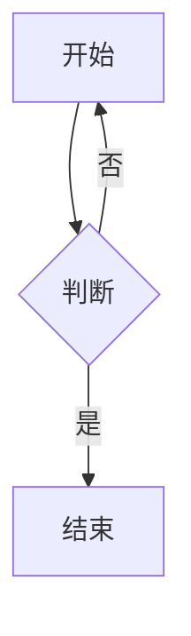

<script setup>
const greeting = '你好，mdi2esm'
const features = ['标题锚点', '代码高亮', 'KaTeX 数学', 'Mermaid 图表']
</script>

# mdi2esm 能力全景

> 本文件是 demo 的**独立 Markdown 源文件**。左侧可实时编辑，右侧渲染。
> 它覆盖 mdi2esm 集成的全部能力：基础语法、容器、GitHub alerts、脚注、任务列表、emoji、CJK 混排、属性、目录、代码高亮、数学、图表、图片缩放，以及宿主注入的 Vue 组件（`<Badge>`）和 `<script setup>`。

::: tip 关于本示例
顶部用了 frontmatter（本段上方 `---` 包裹的 `title` / `description`）和一个 `<script setup>`，它们由 `createMarkdownComponent` 完整管线处理。下面的 `{{ greeting }}` 就是 setup 里定义的响应式文本：**{{ greeting }}**。
:::

## 目录

[[toc]]

本页正文的 `[[toc]]` 会自动生成目录。右侧"大纲"栏则由 `buildOutline(headings)` 从 h2–h6 生成，两者独立。

## 1. 基础语法

普通段落，支持 **加粗**、_斜体_、~~删除线~~、`行内代码`，以及 [外部链接](https://example.com) 和 [邮件](mailto:a@example.com)。

> 这是一段引用。
> 引用可以有多行。

- 无序列表项 A
- 无序列表项 B
  - 嵌套项 B1

1. 有序列表项一
2. 有序列表项二

---

| 能力       | 提供方               | 说明                             |
| ---------- | -------------------- | -------------------------------- |
| 表格可滚动 | applyTablePlugin     | 表格带 `tabindex="0"`            |
| 实体还原   | applyRestoreEntities | 裸 `&` 转 `&amp;`，`&copy;` 保留 |

A & B &copy; C，裸域名 example.com 不会自动成链（`fuzzyLink: false`）。

## 2. 自定义容器

八种内置容器，支持自定义标题、`{no-title}`、`{open}`：

::: info
默认标题的 info 容器。
:::

::: note 这是自定义标题
note 容器，标题写在类型后面。
:::

::: important
重要提示。
:::

::: caution
小心操作。
:::

::: warning 无标题示例 {no-title}
本容器用了 `{no-title}`，不渲染标题栏。
:::

::: details 点击展开（默认折叠）
折叠内容，支持 **Markdown**。
:::

::: details 默认展开 {open}
本容器带 `{open}`，打开页面即展开。
:::

::: danger
危险操作警告。
:::

## 3. GitHub Alerts

用 `> [!TYPE]` 语法，渲染成与自定义容器同款 block：

> [!TIP]
> 这是一条 TIP alert。

> [!NOTE] 带标题的 NOTE
> 标题写在类型后面。

> [!WARNING]
> 这是一条 WARNING alert。

## 4. 任务列表

- [x] 已完成：标题锚点
- [x] 已完成：代码高亮
- [ ] 待办：阅读本文
- [ ] 待办：试试编辑左侧源码

## 5. 脚注

正文里的脚注引用[^1]，以及行内脚注^[这是行内脚注内容]。

[^1]: 这是脚注定义，可以包含 **Markdown**。

## 6. Emoji 与 CJK 混排

Emoji 短码：:smile: :tada: :+1: :heart: :rocket: :100:

CJK friendly：这是**中文**加粗English混排，数字123与汉字相邻，无需手动加空格即可正确解析强调标记。

## 7. 属性语法与标题锚点

带属性的标题 {#custom-heading .my-class}

把鼠标移到上面的标题，可见自动生成的锚点（`.header-anchor`）；`{#custom-heading}` 覆盖默认 slug，`.my-class` 作为类名挂到标题上。普通文本里的 **加粗**{.highlight} 也能加属性。

## 8. 代码高亮

### 8.1 语法着色与行高亮

```js [示例.js] {1,3} :line-numbers=2
const a = 1;
const b = 2;
const c = 3;
const d = 4;
const e = 5;
```

`[示例.js]` 给代码块加标题，`{1,3}` 高亮指定行，`:line-numbers=2` 从第 2 行开始编号。

### 8.2 代码组（多 Tab）

::: code-group

```js [npm]
npm i mdi2esm
```

```pnpm [pnpm]
pnpm add mdi2esm
```

```yarn [yarn]
yarn add mdi2esm
```

:::

点击 Tab 可切换代码块。

### 8.3 关闭行号

```ts:no-line-numbers
const plain = true
```

## 9. 数学公式（KaTeX）

行内公式 $E = mc^2$，块级公式：

$$
\int_0^1 x^2 \, dx = \frac{1}{3}
$$

段落内联 `$$a+b$$` 按块级处理；价格 \$5 不会被误当成公式。公式由 `renderMath()` 异步渲染。

## 10. Mermaid 图表



点击右上角"深色"按钮切换主题，Mermaid 会随 `html.dark` 自动重绘。

## 11. 图片与缩放


[](https://example.com)

点击第一张图片可用 medium-zoom 放大（图为本地资源，离线也能显示）；被链接包裹的图片按规则排除缩放。图片还被自动加上 `loading="lazy"`。

## 12. Vue 组件（Badge）

徽标由宿主提供：`demo/vp-badge.js` 定义 `VPBadge`，渲染后通过 `component.components` 注入管线（mdi2esm 不内置）。每个徽标独占一段，避免被 markdown-it 当成嵌套标签：

<Badge text="new" type="tip"></Badge>

<Badge text="beta" type="warning"></Badge>

<Badge type="danger">插槽内容</Badge>

`<Badge>` 支持 `text` / `type` 与默认插槽。这类 HTML-in-Markdown 需要 Vue 运行时，纯 `renderMarkdown` + `innerHTML` 的挂载方式无法演示。

## 12.1 自定义容器（config 驱动）

::: demo
这是一个**自定义容器**类型 `demo`，由 demo 的 config 里 `markdown.container` 配置注入，不属于内置八种。
:::

内置容器写死在包里；自定义容器需要宿主在 `createConfig({ markdown: { container: [{ type, title }] } })` 里声明，再用 `::: 类型名` 触发。

## 13. 脚本能力（script setup）

顶部 `<script setup>` 定义了 `features`：

脚本里定义的响应式绑定可直接在正文模板里插值，例如：**{{ greeting }}**。

<script>
export default {
  mounted() {
    console.log('[mdi2esm demo] 文档组件已挂载')
  }
}
</script>

## 14. 大纲

右侧"大纲"栏由 `buildOutline(headings)` 从本页 h2/h3 生成。试试增删二级/三级标题，大纲会同步更新。
